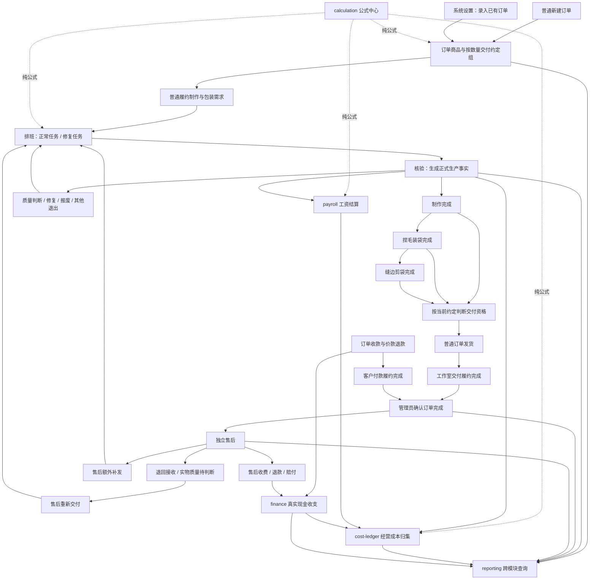
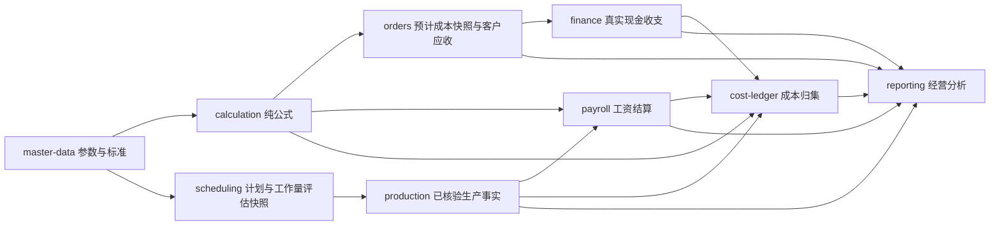

# YUMI V2 制作核心目标架构设计

> 文档类别：架构基线
>
> 权威范围：业务范围、模块所有权与总体依赖方向
>
> 统一导航：`docs/00-文档总览.md`

> 状态：已确认目标设计
>
> 日期：2026-09-29
>
> 适用范围：YUMI V2 订单履约、制作与包装加工、排班核验、发货、售后、成本归集、工资结算及真实现金收支
>
> 本文描述目标架构。现有固定路线、统一可发货节点、公共库存与跨订单领用等实现均按迁移对象处理，不再作为目标设计依据。

## 1. 设计结论

YUMI V2 服务于捏捏手工工作室。制作是唯一必经的核心工序；捏毛装袋、缝边剪袋属于制作完成后的包装加工。系统采用单一 Spring Boot 应用、单一 MySQL 数据库和内部多模块的模块化单体，不拆微服务，不引入通用流程引擎。

目标模型围绕以下主线组织：

```text
客户订单需求
→ 制作产出
→ 可选包装加工
→ 按交付约定发货
→ 工作室交付履约与客户付款履约
→ 订单完成
→ 完成后的新事项进入独立售后
```

系统按数量管理同一商品和制作规格，不逐件编号。客户要求、实物当前状态、加工历史、质量责任、客户收费、经营成本和真实现金收支分别建模，不用单一状态或金额字段混合表达。

## 2. 完整业务总图



## 3. 全局架构原则

### 3.1 模块化单体

- 单一 Spring Boot 应用和单一部署单元。
- 单一 MySQL 数据库。
- 业务模块通过公开应用接口或端口交互。
- 禁止跨模块直接访问 Entity、Repository 或数据库表。
- 跨模块强一致操作在同一个 MySQL `@Transactional` 事务中原子完成。
- 查询报表可以通过公开查询端口组合数据，不得反向修改业务事实。

### 3.2 事实、快照与投影

系统区分三类数据：

1. **不可变业务事实**：订单确认、核验、加工、还原、发货、退回、责任认定、收付款、成本归集等已经发生的业务。
2. **业务快照**：订单确认时的交付约定与预计成本、任务安排时公开接口返回的工作量评估和规则版本、发货时的约定版本等。
3. **当前投影**：当前制作缺口、工序数量、修复池、累计发货、待收金额等，用于高效查询和校验。

已经确认的事实不直接覆盖。录入错误使用引用原事实的追加更正记录，并更新当前投影。

### 3.3 数量管理

- 同一商品、同一制作规格按数量管理，不逐件编号。
- 不建立无订单公共制品池。
- 不建设跨订单制品领用。
- 不建设复杂库存逆向模型。
- 转线下摆摊、内部留用、赠送只记录退出事实，不继续管理后续库存、销售和收入。

### 3.4 金额口径分离

以下口径不能互相替代：

- 订单预计成本；
- 已归集经营成本；
- 客户成交价和处理收费；
- 员工工资结算结果；
- 真实现金收入和支出。

## 4. 模块划分

```text
master-data    商品、客户、员工、生产小组、静态数据、商品录入默认值
calculation    纯数值公式、精度和代码化规则版本
orders         订单、交付约定、变更、普通发货、订单资金、完成事实、已有订单接管
production     制品物理阶段、加工历史、质量、责任、处置、来源消费和数量投影
scheduling     正常/修复任务、员工/小组执行主体、工作量评估快照、生产来源占用引用、取消和核验入口
workforce-coordination  scheduling 与 master-data 的小组配置变更编排，不拥有业务事实
fulfillment-coordination  production 与 scheduling 的跨模块事务编排，不拥有业务事实
after-sales    完成订单后的售后案例、义务、退回、重新交付、额外补发、售后金额与完成事实
payroll        员工工资、责任修复、扣款、免扣额度、封账与补差
cost-ledger    经营成本归集、分摊、更正与成本分析基础
finance        客户及经营活动的真实现金收支
reporting      跨模块只读查询、对账和经营分析
platform       认证、权限、文件、审计、幂等和请求上下文
```

`after-sales` 是独立顶级业务模块，拥有订单完成后的售后案例、售后义务、处理路线、售后交付、售后结算决定和完成事实。它通过公开端口请求 `production`、`scheduling` 和 `finance` 的完整能力，但不修改原订单事实、生产物理状态、排班任务或真实现金事实。售后任务创建和取消仍由 `scheduling` 作为命令所有者；未来若一个售后动作需要同时修改既有排班与生产，必须先登记具名协调端口和事务矩阵，不能直接编排两个模块。

### 4.1 商品、工序预算与定制方案

商品属于 `master-data`，拥有商品身份、核心制作规格和用于接单前估算的标准预算。制作规格包括商品克重、制作标准分钟、模具数量和每日批次数；这些字段与商品一一对应、没有独立生命周期，首期不拆成通用多规格模型。商品单日最大物理产能为“模具数量 × 单模每日标准批次数”，它是工作室范围内按业务日期和商品汇总的总上限；同一天分配给所有个人与小组的该商品有效任务计划数量合计不得超过该上限。

商品预算不能只保存一个混合总成本。系统按工序建立结构化预算模板，并在每道工序内区分人工成本和具体物料成本：

```text
商品标准预算
├─ 制作（必经）
│  ├─ 制作人工
│  ├─ 胶水
│  ├─ 色浆
│  └─ 其他制作物料
├─ 捏毛装袋（可选）
│  ├─ 装袋人工
│  ├─ 袋子
│  ├─ 填充物
│  └─ 其他装袋物料
├─ 缝边剪袋（可选）
│  ├─ 缝边剪袋人工
│  ├─ 缝线
│  └─ 其他缝边剪袋物料
├─ 商品级预计分摊
│  ├─ 模具摊销
│  ├─ 日常杂费
│  └─ 房租水电
└─ 交付级预算项目
   ├─ 装箱
   ├─ 外层运输包装
   └─ 标准运费估算
```

每个物料项至少表达所属工序、物料类型、标准用量、计量单位、预算单价和预算成本。物料类型使用受控目录或明确代码，不采用任意键值的 EAV 参数模型。只有拆到具体物料项，订单才能表达“客户提供胶水、工作室提供色浆”而不是把整道制作物料成本一并归零。

商品创建成功时自动生成一个内置标准方案，用于展示正常预计成本和利润；它不是用户选择的默认方案，不能单独编辑，其内容随商品基本字段、工序字段和额外字段的正式修改同步更新。商品还可以建立多个结构化定制预算方案，保存交付终点、各工序预算模板、各物料供应方、成交价格及预算结果。定制方案是预算和录单模板，不是订单业务事实；创建订单时复制所选方案内容，允许按本次交易调整，确认后由交付约定组独立冻结。订单也允许不选择定制方案而直接采用内置标准方案形成交付约定。商品和方案都不提供服务端草稿，预览只读且不持久化。

商品预算同时区分：

- 标准完整资源成本：按方案所含工序计算全部人工和物料的标准价值；
- 工作室承担预计成本：排除客户自供物料后由工作室预计承担的部分；
- 客户自供材料标准价值：客户提供物料按当前标准预算计算的参考价值；
- 预计收入、预计利润和预计利润率。

客户自供只改变本次方案或交付约定的成本承担方，不改变商品制作规格，也不删除物料需求。首期不据此建立客户材料库存、领用、消耗、退回或余额管理。

`calculation` 负责工序预算、方案汇总和利润的纯公式；`master-data` 保存商品当前预算模板、定制方案及其计算快照；`orders` 保存本次交付约定与预计成本快照；`payroll` 决定正式工资；`cost-ledger` 只归集已发生经营成本；`finance` 只记录真实现金收支。

## 5. 订单与交付约定

### 5.1 普通新订单

普通新订单从零生产进度开始。订单确认时创建订单商品，并允许同一商品按数量形成多个交付约定组。

每个交付约定组至少保存：

- 订单商品；
- 来源商品定制方案，可空；
- 有效约定数量；
- 要求交付阶段：制作完成、捏毛装袋完成或缝边剪袋完成；
- 本次采用的各工序标准与包装规格；
- 按具体物料项保存的供应方约定；
- 成交价约定；
- 按工序、人工和具体物料拆分的预计成本快照；
- 标准完整资源成本、工作室承担预计成本和客户自供材料标准价值；
- 预计利润与预计利润率；
- 生效版本和来源订单变更。

示例：

```text
商品甲100件
├─ 40件：制作完成交付
├─ 30件：使用客户袋子，捏毛装袋后交付
└─ 30件：使用工作室袋子，缝边剪袋后交付
```

### 5.2 客户自供材料

首期按具体物料项记录供应方及其对预计成本的影响，不使用覆盖整道工序的笼统“客户供料”字段。例如制作工序可以同时约定客户提供胶水、工作室提供色浆；捏毛装袋工序可以约定客户提供袋子、工作室承担装袋人工。

客户自供物料仍保留标准用量和标准价值，但不计入工作室承担预计成本。首期不管理客户材料的入库、领用、消耗、退回和余额。材料供应方不自动决定成交价格，也不自动决定客户是否获得价格减免。

客户承诺在售后中提供袋子等材料但尚未提供时，对应客户配合义务未完成，并阻断该售后完成。

### 5.3 订单变更

订单完成前可以按数量变更：

- 有效订购数量；
- 交付阶段；
- 包装要求；
- 材料供应方；
- 成交价格；
- 处理费用和减免；
- 收货资料及其他商业约定。

订单变更通过拆分、合并或新建交付约定版本表达，不覆盖历史约定。已发货数量保留发货时的约定和价格快照，不能被后续变更覆盖。

订单变更确认前调用生产和排班模块评估：

- 当前各实物状态数量；
- 可重新归组数量；
- 必须包装还原的数量；
- 冻结或不可处理数量；
- 变更后的制作与包装加工缺口；
- 受影响的未核验排班任务及其员工、日期、占用数量和版本。

存在受影响的未核验任务时，系统只展示影响，不自动取消或缩减任务。管理员必须逐项核实任务是否可以取消；确认结果绑定本次订单变更、具体任务和任务版本，不能复用于其他命令。

管理员确认后，由 `orders` 在正式订单变更事务中调用 `fulfillment-coordination`；协调器统一协调 `scheduling` 取消全部受影响任务、`production` 释放来源占用并调整实物归组与生产缺口，随后由 `orders` 写入新的交付约定和金额事实。不要求管理员先到排班模块单独取消。

任一任务已经核验、管理员未确认取消，或提交时任务状态和版本发生变化，整次订单变更拒绝。不能只取消部分任务后提交部分订单变更，也不能绕过任务直接缩减对应需求。管理员必须先处理任务或调整变更方案后重新提交。

### 5.4 变更收费

交付约定变化不机械地按新数量和新单价重算全部订单金额。系统分别保存：

- 原订单成交价款；
- 未加工部分的新商业约定；
- 已发生重复工作的处理费；
- 已消耗材料费用；
- 减免；
- 双方协商结果。

客户原因造成包装还原、重新包装或其他额外工作时可以收费；工作室原因通常由工作室承担，也允许管理员按协商结果选择客户承担、工作室承担、双方分担或免收。原因和责任只提供决策依据，不自动决定收费金额。

## 6. 制品与包装状态

### 6.1 状态维度

`production` 只拥有制品物理、质量、处置和来源数量，不使用一个混合状态同时表达加工阶段、质量、发货和售后履约。

物理加工阶段：

```text
尚未制作
制作完成
捏毛装袋完成
缝边剪袋完成
```

质量处理状态：

```text
质量正常
质量待判断
待修复
待报废
已报废
售后待重新加工
```

来源参与状态：

```text
参与普通订单履约
保留给指定售后义务
已被交付消费
已退出普通履约
已耗尽
```

“已发出”不是生产物理状态。普通发货事实由 `orders` 拥有，售后重新交付和额外补发事实由 `after-sales` 拥有；`production` 只保存生产来源消费事实、来源剩余数量和来源参与状态。

“售后退回待判断”也不是跨模块共享状态。`after-sales` 保存退回义务和退回接收事实；退回实物进入生产处理后，`production` 保存其当前物理阶段和质量待判断状态。

当前生产投影必须关联订单商品、交付约定组或售后义务、需求来源、加工阶段、包装规格、材料供应约定、质量状态、来源参与状态和数量。

### 6.2 包装顺序

包装加工顺序固定：

```text
制作完成 → 捏毛装袋完成 → 缝边剪袋完成
```

不能跳过捏毛装袋直接缝边剪袋。制作、装袋或缝边完成均可能成为交付终点，具体由当前交付约定决定。

### 6.3 包装还原

管理员可以直接执行：

```text
捏毛装袋完成 → 制作完成
缝边剪袋完成 → 制作完成
```

还原：

- 追加包装还原事实；
- 调整当前实物状态；
- 不建立线下还原任务；
- 不要求核验；
- 不冲销原包装人工、材料和历史成本；
- 不删除原加工历史；
- 不自动创建重新包装排班。

包装还原只能作用于尚未被普通发货或售后交付消费的数量。实物已经交付时，必须先通过退回接收事实重新进入生产处理，不能直接还原原交付来源。

被未核验排班任务占用时，管理员必须确认取消影响；确认后由 `fulfillment-coordination` 统一协调 `scheduling` 取消任务、`production` 释放占用并追加还原事实。任务已经核验、管理员未确认取消，或提交时任务版本变化时，整次还原拒绝。

首期不提供“缝边剪袋完成直接还原到捏毛装袋完成”。

### 6.4 快照所有权与引用

每类快照只有一个定义所有者。所有者负责创建、版本化、持久化、查询和保留；其他模块只保存由所有者定义的强类型 `SnapshotRef`。跨模块历史查询、重建和结算通过所有者公开查询接口解析，禁止直接访问快照表、Repository 或复制快照载荷。系统不建设全局快照中心。下游模块可以形成语义不同的本模块快照或结算结果，但必须引用上游快照。

## 7. 数量模型

### 7.1 普通制作缺口

```text
普通制作缺口
= 当前有效未发普通需求
- 当前仍参与普通履约的未发制品数量
```

仍参与履约的制品包括制作完成、装袋完成、缝边完成、质量待判断、待修复和尚未正式退出的待报废数量。

已发货、报废、摆摊、内部留用、赠送和因订单减量退出的数量不再参与普通履约。

### 7.2 包装加工缺口

```text
待装袋数量
= 要求至少装袋的有效制品
- 已完成且符合当前约定的装袋或缝边数量
```

```text
待缝边剪袋数量
= 要求缝边剪袋的有效制品
- 已完成且符合当前约定的缝边数量
```

加工阶段更深但包装规格或材料约定不匹配时，不能计为满足。

### 7.3 退出与缺口恢复

包装还原只改变包装状态，不增加制作缺口。

报废、摆摊、内部留用、赠送等制品退出履约时，如果对应客户有效需求没有减少，则自动恢复同数量的制作缺口，但不自动创建排班任务。

质量待判断、待修复和待报废在正式退出前仍属于订单内制品，不提前恢复制作缺口。

### 7.4 需求来源

生产需求至少区分：

```text
普通订单履约需求
售后重新交付需求
售后额外补发需求
```

不同来源共用任务、核验和质量模型，但制作缺口、包装缺口、发货和统计必须保持来源可追溯。

## 8. 排班与任务

### 8.1 模块职责

`scheduling` 管理“准备让谁在何时做什么”；`production` 管理“核验后实际发生了什么”。排班不能直接修改制品状态，生产模块不能自行创建排班任务。

### 8.2 任务类别与业务来源

任务类别只分为正常任务和修复任务。正常任务来源于制作或包装加工缺口，包括制作、捏毛装袋和缝边剪袋；修复任务来源于明确的问题事实和修复池，并且可以安排给不同于原执行员工的人。

订单、售后和已有订单接管是独立的业务来源维度，不作为任务类别。任一业务来源都必须引用冻结路线和明确生产需求；售后或接管任务根据实际工作内容落入正常任务或修复任务。

### 8.3 任务状态

```text
已安排
已取消
已核验
```

系统不设置开工、进行中、暂停和完工待核验。未核验任务均可取消；已核验任务不能取消。

### 8.4 数量占用

创建正常任务时占用对应正常可排余额；创建修复任务时占用指定问题的修复池余额。占用只用于防止重复排班，不产生制品和生产事实。

```text
未占用可排余额
= 来源池有效数量
- 未取消、未核验任务占用
```

取消任务时释放全部来源占用并结束活动执行主体分配；不更新任何可变产能余额。

### 8.5 执行主体与工作量评估

排班执行主体可以是单个员工或小组。小组按一个执行主体和共同产出管理，系统不把倒胶、填色、画画等内部协作步骤拆成独立任务，也不在排班中记录成员个人完成数量或分摊个人贡献。

同一执行主体同一天可以安排多个不同商品的正常任务。排班负责锁定并汇总自己拥有的活动计划，然后调用 `master-data.WorkloadAssessmentQuery`。该接口在提供方内部读取员工/小组、商品标准和有效工作时间标准，并通过 `calculation` 公开纯计算接口返回：

- 标准分钟和可用分钟；
- 新任务加入前后的计划分钟；
- 剩余分钟和负载率；
- `UNDER_STANDARD | WITHIN_STANDARD | OVER_STANDARD | UNAVAILABLE` 评估状态；
- 执行主体、商品标准和效率标准的强类型快照引用；
- 公式版本、舍入版本和输入指纹。

个人可用标准分钟为：

```text
工作日小时数 × 60 × 制作有效工时率
```

小组可用标准分钟按完整小组快照人数和全局协作效率因子计算：

```text
工作日小时数 × 60 × 制作有效工时率 × 小组人数 × collaborationEfficiencyFactor(人数)
```

首期效率因子全局统一、只按人数配置并只用于制作工作量规划，不按商品或小组单独配置，也不用于工资分配。启用的协作效率因子必须大于 `1`；缺少对应人数的 ACTIVE 标准时工作量评估返回不可用并拒绝新任务，禁止回退到因子 `1`、最近人数或代码默认值。计划标准分钟仍为各商品“制作标准分钟 × 计划数量”之和。

`scheduling` 不读取主数据表、标准工时表或公式实现，不复制工作量公式和上游快照载荷，也不维护“员工日产能余额”。首期正常任务遇到 `OVER_STANDARD` 或 `UNAVAILABLE` 时整体拒绝；允许创建时保存排班自有评估结果快照和上游 `SnapshotRef`。取消任务后，下一次评估通过活动计划重新得出结果，不执行“释放分钟”。

小组配置不设置组长和可承接范围，任务不能临时选择成员子集。全部成员必须在职可用，且至少一名成员具有 `MAKING` 资格；首期不跟踪倒胶、填色、画画等内部步骤资格。只要小组仍被 `ARRANGED` 计划引用，就不能修改名称、成员或状态；取消计划或完成核验后活动引用释放，当前配置可以修改。页面查询只能用于提示；正式修改由 `workforce-coordination` 在同一事务中先调用 `scheduling.WorkTeamPlanReferenceGuardPort`，再调用 `master-data.WorkTeamMutationParticipantPort`。`TEAM` 任务创建/调整也锁定同一守卫，防止“检查无引用”与“新增引用”并发穿透。小组创建和每次成功变更都由 `master-data` 同步生成新快照；Query 只读，不能在首次引用时补建。历史任务和结算继续通过 `WorkTeamSnapshotRef` 解析原成员。跨模块持久化该引用时必须完整保存 `ownerModule + snapshotType + snapshotBusinessId + snapshotVersion`，不得只保存版本号、内部主键或复制成员载荷。

修复任务首期不进入正常工作量评估，但不代表无偿或不计薪。工资含义由 `payroll` 决定。小组共同产出不拆分为成员生产数量；结算到人由 `payroll` 根据历史小组快照处理，首期均分也属于工资规则，不属于排班或生产规则。

## 9. 核验与生产事实

### 9.1 正常任务核验

```text
计划数量
= 合格数量
+ 待修复数量
+ 报废数量
+ 未完成数量
```

流转规则：

- 合格：进入对应加工完成状态；
- 待修复：产生问题事实并进入对应修复池；
- 报废：退出当前履约来源，并在需求仍有效时恢复同来源制作缺口；
- 未完成：返回原来源的正常可排余额。

未完成不是质量问题，不进入修复池，不自动归责。

### 9.2 修复任务核验

```text
计划修复数量
= 修复合格
+ 继续待修复
+ 报废
+ 未完成
```

- 修复合格：回到问题对应的正常实物状态；
- 继续待修复：产生新问题事实和新修复池，并关联原问题和修复任务；
- 报废：退出履约并按来源恢复制作缺口；
- 未完成：释放回原修复池。

### 9.3 生产事实内容

核验后才产生正式、精细、可追溯的生产事实，至少保存：

- 原任务及来源；
- 员工或小组执行主体和工作日期；
- 商品、工序、任务类别和业务来源；
- 计划数量；
- 排班工作量评估快照引用；
- 排班工作量评估中冻结的有效工作时间输入、主体与效率标准上游快照引用，以及核验采用的规则版本；
- 合格、待修复、报废和未完成数量；
- 问题现象；
- 已知原因；
- 责任状态；
- 材料损失基础；
- 后续修复链；
- 公式和参数版本。

### 9.4 核验更正

已确认核验不可直接编辑。错误统一通过追加差额更正：

- 引用原核验；
- 保存更正前后数量快照；
- 生成状态差额事实；
- 更新当前投影；
- 保留全部历史。

更正不能绕过已发生包装加工、已发货、售后交付、报废、退出履约、成本归集或工资封账等后续事实。更正后的有效来源数量不得低于已经被下游正式事实消费的数量，任何来源余额和状态投影都不得变成负数。

例如核验制作完成 20 件，其中 15 件已经发货，则不能把有效核验数量更正为 12 件。管理员必须先依法更正或处理下游来源关系，或者补录能够证明缺失数量来源的生产事实，再重新提交核验更正。仅影响尚未消费的剩余数量时，更正事实和生产投影在同一事务内更新。

## 10. 质量、责任与处置

### 10.1 概念分离

系统分别记录：

1. 实物质量状态；
2. 实物处置；
3. 问题原因；
4. 责任主体；
5. 原执行员工；
6. 修复执行员工。

制作结果有问题不等于原执行员工有责任。原因可能来自负责人、工作室材料、客户自供材料、客户要求、物流、客户使用或无法确认。

### 10.2 责任认定

核验时数量结果立即生效，原因和责任允许待确认。责任待确认时不能默认归责原执行员工。

责任通过追加事实认定：

```text
问题事实
→ 责任认定1
→ 如有错误，追加责任认定2更正认定1
```

责任认定及更正不修改生产核验事实。

### 10.3 修复与新问题

修复执行员工可以与原执行员工和责任员工不同。修复再次失败时产生新的问题事实，保存上游问题、修复任务、修复执行员工和新的责任状态，不自动继承原问题责任。

### 10.4 处置

受影响数量可以：

- 当前阶段修复；
- 包装还原后重新加工；
- 报废；
- 转线下摆摊；
- 内部留用；
- 赠送；
- 其他明确退出。

摆摊、留用和赠送只记录退出事实。

## 11. 普通发货

### 11.1 动态交付资格

系统不再维护固定 `SHIPPABLE` 工序节点。交付资格由以下条件共同决定：

```text
当前有效交付约定
+ 当前实物阶段
+ 包装规格和材料供应事实
+ 质量允许交付
- 其他冻结
```

阶段兼容关系：

```text
要求制作完成：制作完成、装袋完成、缝边完成均可满足
要求装袋完成：装袋完成、缝边完成可满足
要求缝边剪袋完成：只有缝边完成可满足
```

### 11.2 发货直接确认

首期不保存服务端发货草稿，也不因页面选择提前占用制品。前端查询可交付来源并提交完整发货命令；正式命令按稳定顺序锁定订单、交付约定、生产来源和来源投影，重新校验后直接消费来源并追加两侧追溯记录。并发命令选择同一来源时只允许一个成功。

### 11.3 来源追溯与权威归属

普通发货由 `orders` 拥有发货事实、发货明细、发货时交付约定快照、订单累计有效发货数量和交付履约投影。发货明细按数量关联交付约定组和 `production` 返回的来源消费结果。

`production` 拥有生产来源消费事实、来源剩余数量和来源参与状态。来源可以来自生产核验、修复合格、已有订单接管或售后重新加工事实；同一来源累计消费数量不得超过其有效数量。

生产来源消费证明哪些来源被本次交付消耗了多少，不替代 `orders` 的普通发货事实。`orders` 不直接修改生产来源和制品状态，`production` 不直接修改订单累计发货数量和交付履约状态。

### 11.4 已确认发货保护

已确认发货不能被订单变更、包装还原或生产核验更正覆盖。发货取消、失效或更正必须从 `orders` 的发货事实发起，并在同一事务中同步处理对应生产来源关系，不能由生产模块单独释放已经消费的来源。

记录错误且实物尚未发出时，可以追加发货更正事实并恢复原生产来源。实物已经发出时，禁止通过发货更正恢复来源，必须走退回或售后流程。原发货事实永久保留，更正事实引用原发货及其来源消费关系。

发货已经被有效售后事实引用时，必须先处理售后下游关系。发货已经支撑订单完成事实时，先追加订单完成失效事实，再更正发货和恢复生产来源，并依据当前有效事实重新计算订单履约状态；条件再次满足后仍须由管理员重新确认完成，不能自动删除原完成事实或自动重新完成订单。

## 12. 双向履约与订单完成

### 12.1 工作室交付履约

完成条件：

- 当前有效订购数量全部完成普通交付，或未交付部分已正式减量；
- 没有普通制作和包装加工缺口；
- 没有阻塞普通履约的质量状态；
- 没有相关未核验任务；
- 没有正在执行且会改变交付义务的正式命令。

### 12.2 客户付款履约

```text
订单价款净收
= 累计订单收款
- 累计订单价款退款
```

付款履约完成需要：

```text
订单价款净收 = 当前有效订单应收
```

并且没有尾款、多付款待退、订单价款退款待支付、待确认金额调整和待处理资金更正。

### 12.3 订单状态

```text
已确认
履约中
已完成
已取消
```

订单完成条件：

```text
工作室交付履约完成
且
客户付款履约完成
```

双方履约条件满足后，由管理员点击确认完成。系统在事务中重新校验全部条件并写入订单完成事实。订单完成时间取管理员确认完成事实的发生时间；工作室交付履约达成时间和客户付款履约达成时间分别保留，不能回填为订单完成时间。

数据录入错误导致完成条件实际不成立时，通过业务事实更正使原完成事实失效；这属于数据更正，不是售后。

## 13. 订单资金

### 13.1 当前有效应收

```text
当前订单应收
= 原确认应收
+ 已生效订单金额调整
```

订单金额调整包括订单完成前的数量、价格、处理收费和价款减免。

### 13.2 资金事实

订单资金至少区分：

- 订单收款；
- 订单价款退款；
- 多收款退回；
- 订单金额调整；
- 资金更正。

已确认资金事实不能直接修改或删除，错误通过追加更正处理。多收款退回不再次减少订单应收。

## 14. 售后

### 14.1 业务边界

订单完成后的新客户事项进入独立售后。售后处理中，原订单保持已完成，不重新进入普通履约。

售后状态：

```text
待处理
处理中
已完成
已取消
```

### 14.2 售后类型

- 仅记录问题；
- 仅退款；
- 退货并退款；
- 退回修复后重新交付；
- 退回重新包装后重新交付；
- 退回后更换新制品交付；
- 额外补发；
- 收费重新加工；
- 赔付。

### 14.3 重新交付与额外补发

重新交付：

```text
原制品退回
→ 修复或包装还原
→ 重新加工
→ 再次交付
```

它不增加原订单销售数量。只有退回制品短少、报废或无法复用时，才形成售后重新交付制作缺口。

额外补发表示原制品不退回或不能复用，需要另外提供制品，形成独立售后补发需求。

### 14.4 退回处理

退回实物收到时，`after-sales` 追加退回接收事实并更新售后退回义务；`production` 在同一事务中登记退回实物，将其质量状态设为待判断，并保存当前物理阶段。退回接收事实和生产实物状态分别由两个模块拥有，不使用共享的“售后退回待判断”状态。

退回实物不直接恢复普通可发货数量，不自动进入修复池，也不自动认定责任。判断后可：

- 直接保留给本售后重新交付；
- 进入售后修复池；
- 包装还原后重新加工；
- 报废或以明确原因退出；
- 退还客户。

售后可用制品优先保留给对应售后义务，不形成跨订单公共制品池。

### 14.5 售后双方义务

工作室义务可以包括接收退回、修复、重新加工、重新交付、补发、退款或赔付。客户义务可以包括退回原制品、提供客户材料和支付售后协商费用。

双方在本次售后中的有效义务均完成后，由管理员确认售后完成。责任调查可以继续，不阻断客户售后完成。

### 14.6 售后资金

售后独立记录：

- 售后收费；
- 售后收款；
- 售后退款；
- 售后赔付；
- 售后减免；
- 售后资金更正。

售后资金不反向修改原订单应收和完成状态。

## 15. 录入已有订单

### 15.1 入口和范围

系统设置长期保留“录入已有订单”入口，不限制使用时间和次数，不设置临时开关或特殊初始化权限。

只录仍在履约、客户付款尚未完成或存在系统后续处理事项的订单；不录双方履约完成且无后续管理需要的纯历史订单。

### 15.2 当前事实接管

录入：

- 原订单资料；
- 当前有效订购数量和交付要求；
- 当前工序和质量状态；
- 接管前累计有效发货；
- 接管前累计收退款；
- 当前订单应收和待收。

不补造历史排班、任务、核验、包装加工、逐笔发货和逐笔资金流水。

已有订单默认允许按商品汇总录入，不强制拆分交付约定组；确实影响后续履约时才可选拆组。

### 15.3 数量守恒

```text
当前有效订购数量
= 接管前累计有效发货
+ 尚未制作
+ 当前订单内未发制品
```

历史发货和当前制品不能重复。

### 15.4 确认与修正

接管确认时在同一事务内创建正式订单、期初订单与资金事实、生产当前状态和各类缺口，不创建排班任务。

已确认接管值不能覆盖。错误通过追加差额修正处理，且不能破坏接管后已经发生的生产、发货、售后和资金事实。

## 16. 公式中心 `calculation`

### 16.1 定位

继续扩展现有无持久化 `calculation` 模块，不新增同义公式模块。它负责：

- 金额和比例精度；
- 商品各工序的人工、具体物料和分摊预算；
- 商品定制方案的标准完整资源成本、工作室承担预计成本和客户自供材料标准价值；
- 交付约定组按工序与成本项拆分的预计成本；
- 订单金额、预计利润和预计利润率；
- 工作量评估所需的标准时间、有效工作时间和负载计算；
- 售后加工成本参考；
- 工资纯数值公式；
- 成本归集分摊公式；
- 代码化规则版本。

### 16.2 约束

`calculation`：

- 无数据库表、Repository 和实体；
- 不依赖业务模块；
- 不访问 HTTP、当前时间和登录上下文；
- 只接收不可变输入并返回结果；
- 不保存业务快照和结算结果；
- 公式由代码和测试管理，不建设管理员动态编辑。

公式目录必须覆盖已实现的商品、订单、生产、售后、工资和成本归集分类，并为每项公式关联测试编号和规则版本。

## 17. 工资结算 `payroll`

`payroll` 通过生产和排班公开查询接口取得已核验生产事实、责任认定及任务工作量评估快照引用，并通过 `master-data.WorkTeamSnapshotQuery` 解析历史小组成员，按版本化规则结算到人；不得直接读取任何其他模块表：

- 正常工资；
- 修复劳动；
- 责任修复；
- 报废材料扣款；
- 月度免扣额度；
- 补贴；
- 工资封账；
- 封账后的补发或补扣。

生产模块不保存工资结果，工资模块不得反向修改生产事实。小组生产仍是一份共同产出，`payroll` 生成自己拥有的员工结算明细；首期均分规则、舍入差额归属和补差都由 payroll 版本化管理，不能使用工作量效率因子作为工资比例。责任待确认时不能默认扣原执行员工；责任更正发生在工资封账后时，通过后续补差处理。

## 18. 经营成本归集 `cost-ledger`

### 18.1 定位

`cost-ledger` 建设可追溯的经营成本台账，归集成本事实，不代替公式中心、生产、工资和财务模块。

### 18.2 归集内容

- 已确认工资成本；
- 材料消耗或采购分摊；
- 报废材料损失；
- 修复成本；
- 包装还原和重复加工成本；
- 普通履约成本；
- 售后重新交付成本；
- 售后额外补发成本；
- 运费和其他可归集经营支出；
- 客户承担、工作室承担和双方分担金额。

订单预计成本快照由 `orders` 或 `after-sales` 持有，`cost-ledger` 只通过公开查询端口读取并用于预计与已归集口径对比，不把预计值登记为成本归集事实。

### 18.3 台账结构

每条成本归集事实至少保存：

- 成本类别；
- 来源模块和来源事实；
- 订单或售后；
- 商品和交付约定组；
- 需求来源；
- 金额和币种；
- 归集或分摊规则版本；
- 归集时间；
- 更正的原事实。

已确认归集事实不可覆盖，错误通过追加更正处理。

### 18.4 口径

“已归集成本”表示系统已依据生产、工资和财务事实归集的经营成本。它不自动等于订单预计成本，也不等于某一笔现金付款。

## 19. 真实现金收支 `finance`

### 19.1 范围

`finance` 记录实际发生的现金收入和支出，包括：

- 订单和售后客户收款；
- 订单价款退款；
- 售后退款和赔付；
- 材料采购付款；
- 工资实际支付；
- 房租、水电；
- 运费；
- 报销；
- 其他真实现金收入和支出。

### 19.2 约束

- 真实现金事实必须基于实际收付，不由标准公式生成。
- 工资成本确认不代表工资已经支付。
- 采购付款不代表采购材料已经全部归集到订单。
- 客户收费决定不代表客户已经付款。
- 已确认现金事实不可直接覆盖，错误使用追加更正。

### 19.3 与业务模块关系

`orders` 和 `after-sales` 拥有客户应收、退款与赔付义务；`finance` 拥有实际资金收付。确认收付时由业务模块和 `finance` 通过公开端口在同一事务内更新相关事实和投影。

采购、房租水电等经营支出由 `finance` 记录，再由 `cost-ledger` 按明确规则归集或分摊。首期不因建设 `finance` 而引入客户材料库存或公共制品库存。

## 20. 成本与资金数据流



订单和售后可以同时展示：

- 预计成本；
- 已归集成本；
- 可关联的真实现金收支；
- 向客户收费；
- 预计利润；
- 已归集利润；
- 现金净流量。

界面和报表必须明确标注口径，不合并成含义不清的“实际成本”。

## 21. 关键跨模块事务

### 21.1 订单确认

```text
orders 创建订单与交付约定并冻结预计成本
→ production 初始化普通制作缺口
→ 同一事务提交
```

### 21.2 订单变更

影响评估必须先固化生产与排班版本。存在受影响未核验任务时走协调分支：

```text
orders 锁定订单、交付约定、发货、金额和变更意图
→ orders 调用 FulfillmentOrderChangeCoordinationPort
→ fulfillment-coordination 调用 scheduling，按任务标识升序锁定完整受影响任务集，并由 scheduling 重验其拥有的管理员取消确认、任务状态和任务版本
→ fulfillment-coordination 调用 production，按来源标识升序锁定完整需求、来源、占用和投影集，并重验实物归组、可还原数量、冻结数量和生产缺口
→ fulfillment-coordination 调用 scheduling 使用已锁定集合统一取消任务，不再获取新锁
→ fulfillment-coordination 调用 production 释放任务来源占用并执行归组、还原或缺口调整
→ orders 写入新约定版本、收费和应收调整事实
→ 事实、快照、投影、幂等、审计和已登记提交后任务一次提交
```

没有任务影响但需要调整生产时，`orders` 可以直接调用 `ProductionDemandPort.applyOrderChange`，但 production 锁内必须确认不存在活动任务来源占用。并发任务已经占用时本次变更失败；并发任务尚未占用时，任务后续占用因生产版本或可用量变化失败。只改变 orders 自有快照、价格或应收时不调用其他模块。

任一任务已经核验、管理员未确认取消、影响评估过期、活动占用出现或版本变化时，整个订单变更失败。取消任务、释放占用和订单变更不能部分提交。协调分支遵守 `orders → scheduling → production` 的全局锁序。

### 21.3 排班创建和取消

```text
scheduling 写入或取消任务
→ production 占用或释放来源数量
→ 同一事务提交
```

### 21.4 核验

```text
scheduling 锁定任务
→ production 写入生产事实和数量流转，返回 ProductionVerificationFactRef
→ cost-ledger.CostRecognitionParticipantPort 依据生产核验事实归集可立即确认的成本
→ scheduling 标记已核验
→ 同一事务提交；任一参与端口失败全部回滚
```

工资金额尚未结算时，成本台账只能记录待归集基础，不生成虚假的工资成本。

### 21.5 普通发货

```text
orders 锁定订单、普通交付义务和订单交付投影
→ orders 校验权限、订单状态、交付义务和预期版本
→ production 锁定指定生产来源和来源投影
→ production 校验物理阶段、质量、归属和可用数量
→ production 追加来源消费事实并更新来源余额
→ orders 追加普通发货事实、发货明细和交付约定快照
→ orders 更新订单累计发货数量和交付履约投影
→ 幂等、审计和必要文件关联一起提交
```

任一步失败时，普通发货事实、生产来源消费和两侧投影整体回滚。生产来源消费不替代订单发货事实，生产模块也不能单独释放已经被确认发货消费的来源。

### 21.6 订单收付款

```text
orders 确认订单收款或价款退款业务事实
→ finance 写入真实现金事实
→ orders 更新付款履约投影
→ 同一事务提交
```

### 21.7 售后处理

售后不是一个同时写入生产、排班、资金和成本的综合事务，按实际发生的业务动作拆分：

```text
售后受理
→ after-sales 保存案例、问题、处理路线和双方义务

售后退回接收
→ after-sales 保存退回接收事实
→ production 登记退回实物的物理阶段和质量待判断状态
→ 同一事务提交

售后生产需求确认
→ after-sales 确认重新加工、重新交付或额外补发义务
→ production 建立对应生产需求来源和缺口
→ 同一事务提交

售后创建排班
→ scheduling 创建任务、执行主体和工作量评估快照
→ scheduling 通过公开接口完成评估，不读取主数据或公式底层
→ scheduling 请求 production 占用
→ production 占用对应售后生产来源
→ 同一事务提交

售后重新交付或额外补发
→ after-sales 锁定售后义务和售后履约投影
→ production 消费指定生产来源并更新来源余额
→ after-sales 保存售后交付事实并更新售后履约
→ 同一事务提交

售后实际收款、退款或赔付
→ after-sales 保存售后结算业务事实
→ finance 保存真实现金事实
→ 同一事务提交

售后完成确认
→ after-sales 重新校验双方全部有效义务
→ 保存售后完成事实和义务完成快照
```

仅记录问题、责任、处理路线或未来义务时，不伪造尚未发生的生产、排班、现金和成本事实。`cost-ledger` 在生产核验、工资封账或实际经营支出等权威事实形成后归集成本，不无条件参与售后受理和完成事务。`after-sales` 不直接写排班；售后任务由 `scheduling` 完整命令创建或取消。当前 `fulfillment-coordination` 没有售后调用方，未来跨既有排班与生产的售后动作必须先新增具名协调用例。

履约协同入口只提供跨 `production` 与 `scheduling` 的事务编排，不拥有业务事实：

```text
fulfillment-coordination
├─ OrderFulfillmentChangeCoordination
├─ PackagingRestorationCoordination
└─ QualityDispositionCoordination
```

## 22. 核心应用端口

公开能力名称固定如下；实现包名按模块 `api` 包规则落地，不得修改能力语义：

```text
workforce-coordination
├─ WorkTeamConfigurationCoordination
└─ WorkTeamChangeImpactQuery

fulfillment-coordination
├─ OrderFulfillmentChangeCoordination
├─ PackagingRestorationCoordination
└─ QualityDispositionCoordination

orders
├─ OrderDemandQuery
├─ OrderAgreementQuery
├─ OrderChangeApplication
├─ ShipmentApplication
├─ OrderSettlementApplication
├─ OrderCompletionApplication
└─ LegacyOrderIntakeApplication

production
├─ ProductionDemandPort
├─ ProductionTaskReservationPort
├─ ProductionVerificationPort
├─ ShipmentSourcePort
├─ ProductionQueryPort
├─ ProductionOrderChangeParticipantPort
├─ ProductionDispositionParticipantPort
└─ ProductionReturnPort

scheduling
├─ ScheduleApplication
├─ TaskCancellationApplication
├─ TaskCancellationConfirmationApplication
├─ VerificationSubmissionApplication
├─ WorkTeamPlanReferenceGuardPort
├─ SchedulingOrderChangeParticipantPort
└─ SchedulingDispositionParticipantPort

after-sales
├─ AfterSalesIntakeApplication
├─ ReturnReceiptApplication
├─ AfterSalesProductionDemandApplication
├─ RedeliveryApplication
├─ ReplacementApplication
├─ AfterSalesSettlementApplication
└─ AfterSalesCompletionApplication

payroll
├─ PayrollCalculationApplication
├─ PayrollClosingApplication
└─ PayrollCostQuery

cost-ledger
├─ CostRecognitionApplication
├─ CostRecognitionParticipantPort
├─ CostAllocationApplication
├─ CostCorrectionApplication
└─ CostLedgerQuery

finance
├─ CashReceiptApplication
├─ CashPaymentApplication
├─ CashCorrectionApplication
└─ CashJournalQuery
```

## 23. 概念数据模型

以下为概念数据对象，不预先锁定最终表名。

### 23.1 商品与预算模板

```text
products
product_process_budget_templates
product_process_material_budgets
product_cost_allocation_budgets
product_customization_profiles
product_customization_processes
product_customization_material_terms
product_customization_budget_snapshots
```

`product_process_budget_templates` 按制作、捏毛装袋和缝边剪袋保存标准分钟与人工预算；`product_process_material_budgets` 保存胶水、色浆、袋子、填充物、缝线等具体物料的标准用量、单位、预算单价与预算成本；`product_customization_profiles` 组合工序、物料供应方和默认成交价。上述对象都属于商品主数据及预算模板，不代表订单事实或已发生成本。

### 23.2 订单

```text
orders
order_items
delivery_agreement_groups
delivery_agreement_versions
delivery_agreement_process_snapshots
delivery_agreement_material_terms
delivery_agreement_cost_snapshots
order_change_orders
order_change_impacts
order_charge_decisions
order_receivable_facts
order_payment_obligations
order_fulfillment_projections
order_completion_facts
legacy_order_intakes
legacy_order_intake_corrections
```

### 23.3 生产与排班

生产和排班的字段级设计分别见：

- `docs/02-模块设计/03-生产模块.md`；
- `docs/02-模块设计/04-排班模块.md`。

两份模块设计共同冻结需求、来源、来源占用、物理阶段、质量、修复、任务、执行主体、工作量评估快照和核验的所有权。生产来源余额由 `production` 拥有，排班只保存来源占用引用；标准与评估能力由 `master-data`/`calculation` 通过公开接口提供；排班核验提交由 `scheduling` 拥有，正式生产事实由 `production` 追加。

```text
production
├─ production_demand_projections
├─ product_quantity_facts
├─ product_state_projections
├─ packaging_process_facts
├─ packaging_restoration_facts
├─ quality_issue_facts
├─ quality_disposition_facts
├─ responsibility_determinations
├─ responsibility_corrections
├─ repair_pools
├─ production_verification_facts
├─ verification_corrections
├─ production_source_facts
├─ production_source_projections
├─ task_source_reservations
└─ shipment_source_consumption_facts

scheduling
├─ schedule_tasks
├─ schedule_task_lines
├─ schedule_task_assignments
├─ schedule_assignment_change_facts
├─ task_workload_assessment_snapshots
├─ schedule_subject_day_guards
├─ task_cancellations
├─ task_cancellation_confirmations
├─ verification_submissions
├─ verification_submission_lines
├─ verification_submission_corrections
└─ scheduling_workbench_projections
```

### 23.4 发货与售后

```text
shipments
shipment_items
shipment_source_links
shipment_corrections
after_sales_cases
after_sales_obligations
return_receipts
redelivery_obligations
replacement_obligations
after_sales_charge_decisions
after_sales_payment_obligations
after_sales_completion_facts
```

### 23.5 工资、成本与财务

```text
payroll_periods
payroll_calculation_runs
payroll_employee_results
payroll_adjustments
cost_ledger_entries
cost_allocation_runs
cost_ledger_corrections
cash_transactions
cash_transaction_allocations
cash_transaction_corrections
```

## 24. 现有模型替换范围

目标架构要求撤回或重构以下现有假设：

1. 固定“制作 → 装袋 → 可选缝边 → 统一可发货节点”路线；
2. `SHIPPABLE` 作为固定生产节点；
3. `seam_quantity` 作为整条订单明细唯一流程分桶；
4. `order_item_snapshots.flow` 保存固定流程文本；
5. 同一订单商品只有一套价格、包装和材料约定；
6. 公共库存池和跨订单领用；
7. 复杂库存逆向流水；
8. 发货统一消费 `SHIPPABLE` 投影；
9. 订单变更直接覆盖整条订单商品当前值；
10. 减量处理仅支持转成品余量或报废；
11. 发货作废与库存恢复混合；
12. 普通履约、售后重新交付和额外补发共用同一数量；
13. 用固定路线和简单资金净额判断订单关闭；
14. 把标准成本、工资结果和真实现金支出混为“实际成本”；
15. 商品只保存一套混合总成本，无法区分各工序人工、具体物料及客户自供影响；
16. 用整道工序的笼统材料供应方替代胶水、色浆、袋子等具体物料约定；
17. 把商品预算模板直接当成订单确认事实。

现有 `calculation` 公式中心保留并扩展；商品、订单、工作量评估和生产公式需要适配新的交付约定、员工/小组共同产出与按工序成本口径。业务模块只能调用公开纯计算接口，不复制公式。

## 25. 迁移与切换门禁

目标架构不是通过一次性删表完成。进入任何业务实现前，必须建立旧模型到新模型的可审计映射表，至少覆盖：

| 旧模型 | 新模型 | 迁移口径 | 无法映射时的处理 |
|---|---|---|---|
| 固定路线、`SHIPPABLE` | 交付约定组、生产阶段与交付资格 | 按订单/明细/来源逐条生成快照和资格事实 | 进入数据质量队列，不静默归入可发货 |
| `seam_quantity` | 制作/包装阶段数量事实和投影 | 按原记录时间、数量、阶段语义拆分 | 标记为需人工确认 |
| 公共库存池、跨订单领用 | 生产来源与指定用途占用 | 仅能在证据足够时建立来源消费链 | 禁止猜测来源，保留迁移异常 |
| 旧发货记录 | orders 普通发货事实与 production 来源消费事实 | 保留原业务时间、操作人和来源证据 | 进入不可自动切换清单 |
| 旧收付款/资金净额 | orders 资金义务与 finance 现金事实 | 区分业务义务和实际现金事件 | 差异进入对账，不用净额补齐 |

切换必须经过以下阶段：

1. **盘点**：冻结旧表、字段、状态、来源关系和数据质量统计；
2. **映射**：生成可重复执行的迁移脚本和逐条映射结果，保存旧标识与新事实标识；
3. **影子校验**：在只读或隔离环境重建新投影，与旧系统按明确口径对账；
4. **双读/灰度**：先让查询按业务范围灰度读取新投影，禁止新旧口径混合写入；
5. **切换**：停止旧模型正式写入，执行最终水位迁移，校验数量、金额、来源和状态不变量；
6. **回退窗口**：保留旧数据只读和迁移批次，回退通过切换读入口或恢复快照，不通过反向猜测业务事实；
7. **收尾**：完成差异清单、人工处理和审计归档后，才允许下线旧表写入口。

迁移必须具备：重复执行不产生第二套事实、每条新事实可追溯到旧来源、无法映射的数据可查询、切换前后可对账、失败可停在明确批次边界。没有映射表、数据质量报告、回退方案和最终对账证据，不得进入生产切换。

## 26. 模块设计完成门禁

`production` 和 `scheduling` 已补充第一版字段级模块设计：

- `docs/02-模块设计/03-生产模块.md`；
- `docs/02-模块设计/04-排班模块.md`。

两份模块设计已经冻结表边界、事实/快照/投影分类、命令与参与端口、状态机、来源分配、锁序、错误码、权限和测试清单；小组配置协同和履约协同模块设计分别见 `docs/02-模块设计/05-小组配置协同模块.md`、`docs/02-模块设计/06-履约协同模块.md`。精确包、文件、接口、调用链见 `docs/02-模块设计/07-生产排班与小组协同开发细化.md`，该文档不定义实施顺序。售后、工资、成本台账、财务和报表的详细设计已经分别落入 `docs/02-模块设计/08` 至 `12`，全系统字段和 Flyway 蓝图见 `docs/01-架构基线/08-完整系统数据库设计.md`。当前待完成的是按唯一实施方案执行工程门禁、真实 MySQL 并发/回滚/重建验证和运行演练，而不是继续保留模块边界空白。

在以下门禁全部通过前，不得进入“生产与排班重构”实现分片：

1. 生产和排班模块设计的表名、所有权和跨模块引用无冲突；
2. `production ↔ scheduling` 的公开端口与禁止依赖通过 Spring Modulith 结构测试；
3. `orders / after-sales → scheduling → master-data → production → payroll → finance → cost-ledger` 的适用子序列通过真实 MySQL 并发和死锁测试；
4. 来源分配、任务取消、核验分桶、成本归集、包装还原和质量处置通过回滚与投影重建测试；
5. `docs/02-模块设计/05-小组配置协同模块.md` 的小组配置变更和 `docs/02-模块设计/06-履约协同模块.md` 的三个履约编排用例完成评审、依赖无环验证与真实 MySQL 原子性测试；
6. Query 只读、快照由所有者变更命令物化、一个事实或确认只有一个所有者等边界通过契约测试。

## 27. 完整系统实施分片

完整系统的权威实施顺序见 `docs/03-实施方案/01-完整系统实施方案.md`。目标架构覆盖全部业务模块、前后端、数据库、迁移、运维和上线，不能再以生产/排班单一分片代替完整计划。

架构层只冻结以下分片原则：

1. 先完成 G0 完整设计和数据库蓝图，再建立 G1 工程与自动化门禁；
2. `platform`、`calculation` 和 `master-data` 必须先于业务调用方；
3. `production`、`cost-ledger`、`finance` 的最小提供方内核必须先于调用它们的订单、排班、售后和工资能力；
4. orders、production、scheduling、after-sales、payroll、cost-ledger、finance、reporting 按总体方案 G5-G12 形成纵向业务闭环；
5. 前端、测试、权限、审计、可观测性和迁移准备随各阶段持续交付，不得集中到最后补做；
6. 最终必须经过数据迁移与切换演练以及全系统上线验收。

每个阶段必须以可运行、可验证的业务闭环交付，不能只创建空表、空接口或未接线页面。模块设计可以提供代码级细节，但实施顺序、阶段编号和准入条件只由唯一完整系统实施方案定义。

## 28. 全局不变量

```text
制作是唯一核心必经工序
包装只能按固定顺序前进
包装可以还原到制作完成
客户交付约定与实物当前状态分开保存
当前状态与加工历史分开保存
已发货事实不可被订单变更或生产更正覆盖
订单完成 = 工作室交付履约完成 + 客户付款履约完成
订单完成后的新业务进入售后
售后不改变原订单完成状态
重新交付不等于额外补发
生产成本不自动决定客户收费
客户收费不反向覆盖生产事实
执行员工不等于责任员工
修复员工不等于原问题责任员工
质量待判断不提前恢复制作缺口
未完成返回原来源池
待修复进入对应修复池
退出履约后按有效需求恢复制作缺口
排班不产生生产事实
核验后才产生正式生产事实
核验和责任错误通过追加更正处理
已有订单只接管当前事实，不补造历史过程
商品预算按工序区分人工和具体物料
客户自供只改变成本承担方，不删除物料需求
商品定制方案是模板，订单交付约定才是事实
calculation 只负责纯公式
快照由定义所有者在创建和变更命令中物化、版本化、查询和保留
Query 只读，不得在首次查询或首次引用时隐式创建快照
其他模块只保存强类型 SnapshotRef，不复制上游快照载荷
一个业务事实或确认只有一个所有者
顶级模块依赖图保持无环
Controller 只调用一个完整命令或查询用例
参与端口只写提供模块自己的表
reporting 只读，不参与业务写入校验
结算模块只保存自己拥有的结算结果
cost-ledger 保存已归集经营成本
finance 保存真实现金收支
工资结算不得反向修改生产事实
所有跨模块强一致动作在同一数据库事务中完成
```
