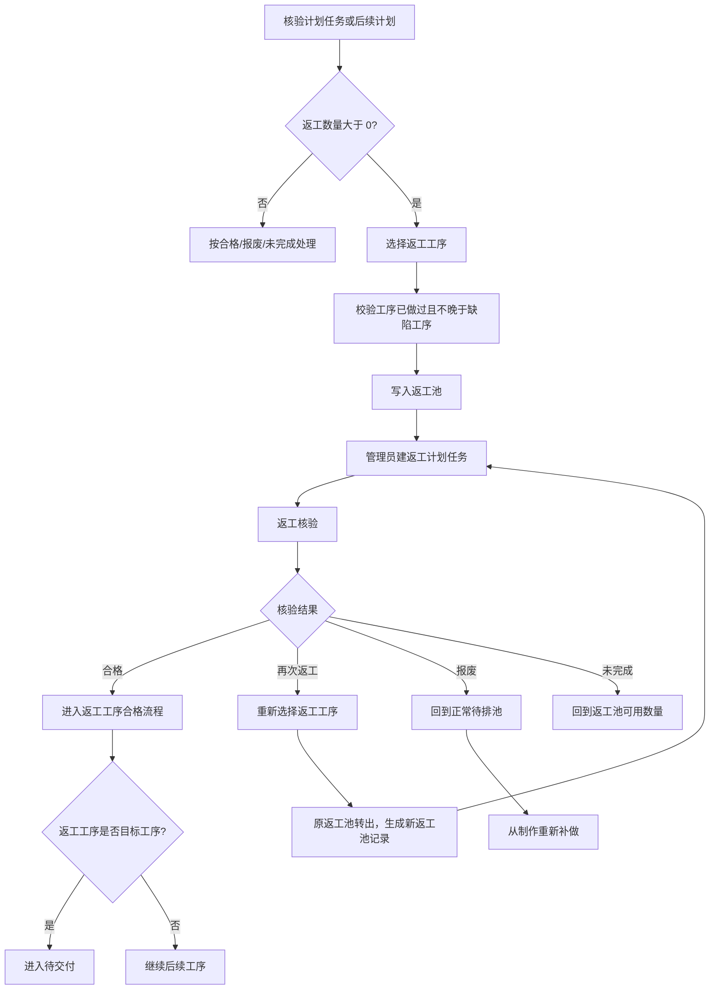
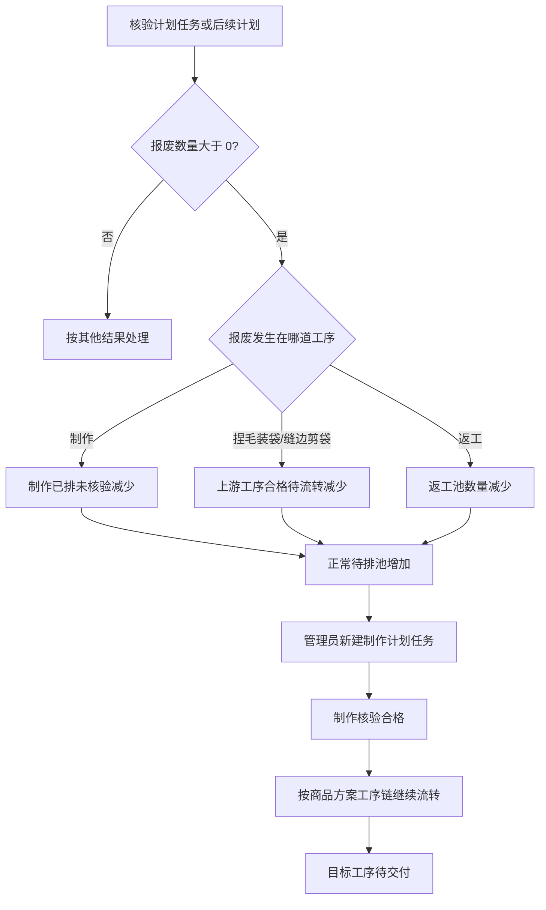

# V3 生产模块

> 模块代码：`production`  
> 文档版本：V3.0  
> 编写日期：2026-10-29  
> 状态：V3 生产模块评审稿；评审通过前不进入页面实现

本文是 V3 生产模块的唯一需求与设计依据。生产模块统一管理排班计划、计划任务、生产记录、正常待排池、返工池和工序流转；不做小组、自定义任务、备货生产、成品库存和工资。

## 摘要

- 一个生产模块，两个工作区：排班计划、生产记录。
- 生产来源只有两种：订单商品、返工。
- 计划头是日期 + 员工 + 一道工序；同一员工、同一天、同一工序只能有一个活动计划。
- 制作计划新建时选择订单商品来源，每个商品生成一条计划任务；正常任务和返工任务可以在同一计划下并存。
- 捏毛装袋、缝边剪袋只排日期、员工和工序，不在计划里建正常任务；核验时从工序流程选择上游来源，生成生产记录。
- 生产记录是核验时生成的真实完成事实，不提前存在；没有计划不能登记生产记录。
- 计划可以提前排，不限定提前多久，不依赖实际产出；后续工序执行时才受上一工序实际合格数量限制。
- 正常待排池、返工池、工序流程和已排未核验之间保持数量守恒。
- 核验结果分为合格、返工、报废、未完成；返工进入返工池，报废和未完成回到正常待排池。
- 返工是在制品修补，不是重新制作；返工是计划任务类型，可以选前面已做过的工序。
- 其他任务排班只给非工序岗位员工安排日期和岗位，例如打包、发货、清洁；不填数量、不做完成确认、不生成生产记录。
- 生产模块自己保存计划、任务、生产记录、返工池和其他任务排班；订单、员工、商品只提供来源和快照引用。
- 数量计算在生产模块本地完成，不调用计算中心；计算中心只保留金额、成本、工资。

## 1. 模块说明

生产模块管理“计划谁哪天做哪道工序、实际完成了什么”。

排班计划负责安排日期、员工和工序；计划任务负责记录制作工序下具体要做的订单商品；生产记录负责记录核验时实际完成的数量和质量结果。打包、发货、清洁这类非工序岗位使用其他任务排班，只记录日期、员工和岗位。

制作工序必须知道做什么订单、什么商品、多少件，所以制作计划下面要有商品任务。捏毛装袋和缝边剪袋无法严格按照制作计划执行，只排谁哪天做哪道工序；实际完成哪些订单商品，在核验时从上游工序流程中选择。

生产模块回答“计划做了什么、实际做了什么、还差多少、返工和报废多少”；订单模块回答“客户和交付”；员工模块回答“谁能做哪个岗位”；商品模块回答“商品方案和工序链”。

## 2. 用户与使用场景

### 2.1 用户

| 用户 | 关心什么 | 在生产模块做什么 |
|---|---|---|
| 管理员 | 未来几天谁做哪道工序、订单还差多少、返工怎么处理 | 建制作计划、排后续工序、处理返工、查看缺口 |
| 生产负责人 | 今天实际完成了什么、合格多少、返工和报废多少 | 核验计划任务或后续计划，登记生产记录 |
| 老板 | 计划进度、实际产出、返工和报废 | 查看计划、生产记录和订单商品进度 |
| 订单 | 商品已合格数量和可发货数量 | 通过生产公开查询读取，不直接读生产表 |
| 工资 | 某员工某天实际完成的生产记录 | 后续通过生产记录或工资模块自己的投影读取 |
| 报表 | 生产、返工、报废和进度汇总 | 通过生产公开查询或后续报表投影读取 |

### 2.2 现状与目标

管理员现在用 Excel 记录订单、商品、兼职每日产出和排班。制作工序按订单排；捏毛装袋和缝边剪袋通常只排人，实际做完后再记录产出。

V3 把这个过程拆成计划和实际两层：

- 制作计划提前排，选多个订单商品，每个商品一条计划任务；
- 后续工序提前排人，不预先绑定订单商品；
- 核验时记录实际完成，后续工序从上游流程中选择订单商品；
- 没做完的回到待排池，返工的进入返工池；
- 订单进度以实际合格数量为准，不以计划数量为准。

## 3. 本期范围

### 3.1 本期提供

- 制作计划创建、查看、取消；
- 制作计划下按订单商品生成计划任务；
- 计划任务的增加、修改和取消；
- 后续工序计划创建、查看、取消；
- 后续工序核验时多选上游流程来源，生成生产记录；
- 制作计划任务逐条核验；
- 返工任务创建、排期、核验；
- 非工序岗位的其他任务排班（打包、发货、清洁等）；
- 生产记录查询；
- 生产记录作废重录；
- 正常待排池、返工池、工序流程和完成数量查询；
- 订单商品生产进度查询；
- 计划和生产记录的权限、审计和幂等。

### 3.2 本期不提供

- 小组、成员、组长、小组效率和小组协同；
- 自定义任务、无订单备货生产、纯手工任务；
- 其他任务的完成确认、工时、生产记录和数量统计；
- 成品库存、入库、出库和库存占用；
- 发货、物流、收款和售后；
- 工资、成本、提成、考勤和工时结算；
- 自动排班、自动分配员工和排产优化；
- 班次、开始时间、结束时间和设备产能；
- 生产记录业务数量直接编辑、删除；只允许作废重录；
- 订单变更、订单取消对已有计划和生产记录的自动调整；
- 跨订单合并生产或同一订单拆成多个生产需求；
- 计划审批流和多级确认；
- 生产绩效和计件金额；
- 计算中心的数量公式调用；
- 通用生产模板。

## 4. 业务概念

| 术语 | 定义 |
|---|---|
| 计划 | 某员工某天做某一道工序的排班头 |
| 计划任务 | 计划下具体要做的订单商品工作，分为正常任务和返工任务 |
| 正常任务 | 制作计划下按订单商品生成的计划任务 |
| 返工任务 | 从返工池排进计划的修补任务 |
| 其他任务排班 | 给非工序岗位员工安排日期和岗位，例如打包、发货、清洁 |
| 生产记录 | 核验时生成的真实完成事实，记录合格、返工、报废和未完成 |
| 正常待排池 | 订单商品还没有排进制作计划的数量 |
| 返工池 | 已经做出但需要修补的在制品数量 |
| 工序流程 | 上一道工序已经合格、可以进入下一道工序的数量 |
| 合格 | 本道工序完成且质量合格的数量，进入下一道工序或达到目标工序 |
| 返工 | 本道工序完成后需要回到前面工序修补的数量 |
| 报废 | 制品损失、无法继续使用的数量 |
| 未完成 | 本次计划内没有完成的数量 |
| 目标工序 | 商品方案要求的最后一道工序；链在这一步结束 |
| 工序链 | 制作 → 捏毛装袋 → 缝边剪袋，按商品方案目标工序截断 |
| 已排未核验 | 已经进入计划任务、但还没有生产记录的数量 |

## 5. 核心数量模型

### 5.1 数量状态

每个订单商品在生产过程中的数量只处于以下状态之一：

```text
正常待排
制作已排未核验
返工池
各工序合格待流转（含已达目标待交付）
```

订单商品数量守恒：

```text
订单商品数量
= 正常待排
+ 制作已排未核验
+ 返工池
+ 各工序合格待流转（含已达目标待交付）
```

### 5.2 状态转移

| 操作 | 数量变化 |
|---|---|
| 制作计划新增正常任务 | 正常待排减少，制作已排未核验增加 |
| 取消制作正常任务 | 制作已排未核验减少，正常待排增加 |
| 制作任务核验合格 | 制作已排未核验减少，制作工序合格待流转增加 |
| 制作任务核验返工 | 制作已排未核验减少，返工池增加 |
| 制作任务核验报废或未完成 | 制作已排未核验减少，正常待排增加 |
| 后续计划核验合格 | 上一工序合格待流转减少，下一工序合格待流转增加；目标工序时进入待交付 |
| 后续计划核验返工 | 上一工序合格待流转减少，返工池增加 |
| 后续计划核验报废 | 上一工序合格待流转减少，正常待排增加；补做从制作重新开始 |
| 后续计划核验未完成 | 数量留在上一工序合格待流转，不移动 |
| 返工任务核验合格 | 返工池减少，返工工序合格待流转增加 |
| 返工任务核验再次返工 | 原返工池转出数量增加，新返工池记录增加；返工池总量不变 |
| 返工任务核验报废 | 返工池减少，正常待排增加 |
| 返工任务核验未完成 | 数量留在返工池 |
| 生产记录作废重录 | 撤销原记录的数量效果，按新记录重新应用；净变化等于新旧结果差异 |

### 5.3 数量说明

- 正常待排只发生在制作工序；所有新制品都从制作开始。
- 正常待排 = 订单数量 − 制作已排未核验 − 返工池 − 各工序合格待流转。
- 后续工序计划不占用正常待排，也不提前移动数量。
- 某条上游生产记录的可用数量 = 该记录合格数量 − 下游记录引用它时已处理的合格、返工和报废数量；未完成不扣减。
- 返工池中的数量不属于正常待排，也不重复占用订单数量。
- 后续工序未完成的数量仍留在上一工序流程，下一次可以直接再排。
- 下游报废从制作重新做一件，补做回到正常待排池。
- 计划数量不等于完成数量；订单进度只取生产记录中的合格数量。
- 其他任务排班不进入正常待排、返工池、工序流程和订单进度，不影响数量守恒。
- 所有数量计算在生产模块本地完成，不调用计算中心。

### 5.4 返工流程

返工只处理有缺陷的在制品，不增加订单数量，也不重新从制作开始；只有返工工序选择制作时，才回到制作环节修补。



返工流程说明：

- 返工数量进入返工池，不进入正常待排池；
- 返工任务必须从返工池创建，不能凭空新建；
- 返工工序可以选择制作、捏毛装袋或缝边剪袋中已经做过的工序；
- 返工合格后，从返工工序继续往目标工序走；
- 返工再次返工时，重新选择返工工序，原返工池转出数量增加，并生成新的返工池记录；
- 返工报废时，数量回到正常待排池，从制作重新做一件；
- 返工未完成时，数量回到原返工池可用数量；
- 返工不增加订单数量，不重复计入合格数量。

### 5.5 报废流程

报废件不能继续使用，订单数量不减少；报废数量回到正常待排池，从制作重新做一件。



报废流程说明：

- 报废数量不留在原工序，也不进入返工池；
- 制作报废：制作已排数量减少，正常待排数量增加；
- 后续工序报废：上游工序合格待流转数量减少，正常待排数量增加；
- 返工报废：返工池数量减少，正常待排数量增加；
- 报废不减少订单数量，补做仍属于同一个订单商品；
- 补做从制作重新开始，按商品方案工序链重新走一遍；
- 报废件不进入成品库存，也不进入售后流程。

### 5.6 返工与报废的区别

| 项目 | 返工 | 报废 |
|---|---|---|
| 对象 | 有缺陷的在制品 | 已经损失、不能继续使用的制品 |
| 是否重新制作 | 否，回选定工序修补 | 是，从制作重新做一件 |
| 数量去向 | 返工池 | 正常待排池 |
| 是否占订单数量 | 不重新占订单数量 | 不减少订单数量，补做仍属于原订单商品 |
| 修好后流向 | 从返工工序继续往目标工序走 | 按完整工序链重新走 |
| 再次失败 | 可以再次返工或报废 | 不再返工，直接补做 |

流程图只表达数量流向；计划取消、权限校验、审计和并发控制仍按第 7、11、13 节执行。

### 5.7 工作量提示

只有制作计划的正常任务需要提示员工当天的工作量；返工任务不计算工作时长，也不参与工作量提示。

```text
制作正常任务预计分钟 = 计划数量 × 商品方案制作工序标准分钟
当天预计分钟 = 员工当天所有制作正常任务的预计分钟合计
```

- 商品方案和制作工序标准分钟来自订单商品冻结的商品/方案快照，不读取商品当前值；
- 返工任务不计算预计分钟，预计分钟固定为 0；
- 后续工序计划没有正常任务，不计算预计分钟；
- 其他任务排班不计算预计分钟，不参与工作量提示；
- 当天预计分钟超过每日可用工作分钟时提示，但允许保存；
- 每日可用工作分钟来自全局模块参数 `DAILY_WORK_MINUTES`；按计划日期读取当时版本，未配置时只显示预计分钟，不做超出提示；
- 预计分钟是计划工作量，按计划任务计算，不按实际完成数量回算；
- 取消的计划或计划任务不再计入当天预计分钟；
- 工作量只做提示，不阻止计划创建或核验；
- 计算在生产模块本地完成，不调用计算中心。

## 6. 字段定义

### 6.1 计划

| 字段 | 必填 | 类型/精度 | 规则 |
|---|---|---|---|
| 计划业务标识 | 系统 | `VARCHAR(64)` | 稳定标识，不对外显示 |
| 计划日期 | 是 | `DATE` | 计划工作的日期 |
| 员工 | 是 | `VARCHAR(64)` | 必须是在职且岗位匹配的员工 |
| 员工快照引用 | 系统 | `VARCHAR(64)` + 版本 | 计划创建时冻结员工身份和岗位 |
| 工序 | 是 | `VARCHAR(32)` | `MAKING / BAGGING / SEAM_CUTTING` |
| 计划状态 | 系统 | `PLANNED / COMPLETED / CANCELLED` | 由任务和生产记录决定 |
| 备注 | 否 | `VARCHAR(500)` | 计划说明 |
| 行版本 | 系统 | `BIGINT` | 并发控制 |

同一员工、同一天、同一道工序只能有一个活动计划；已存在时在新窗口直接追加任务或核验，不重复创建计划。

### 6.2 计划任务

| 字段 | 必填 | 类型/精度 | 规则 |
|---|---|---|---|
| 任务业务标识 | 系统 | `VARCHAR(64)` | 稳定标识 |
| 所属计划 | 系统 | `VARCHAR(64)` | 计划业务标识 |
| 任务类型 | 是 | `NORMAL / REWORK` | 正常任务或返工任务 |
| 订单 | 正常/返工 | `VARCHAR(64)` | 订单业务标识 |
| 订单商品明细 | 正常/返工 | `VARCHAR(64)` | 订单商品明细业务标识 |
| 商品快照引用 | 正常/返工 | `VARCHAR(64)` | 订单商品冻结的商品快照 |
| 方案快照引用 | 正常/返工 | `VARCHAR(64)` | 订单商品冻结的方案快照 |
| 工序 | 系统 | `VARCHAR(32)` | 必须等于计划工序 |
| 计划数量 | 是 | `INT` | 大于 0 |
| 预计分钟 | 系统 | `INT` | 制作正常任务为计划数量 × 制作工序标准分钟；返工任务固定为 0，不参与工作量提示 |
| 返工池引用 | 返工必填 | `VARCHAR(64)` | 返工任务对应的返工池记录 |
| 任务状态 | 系统 | `PLANNED / COMPLETED / CANCELLED` | 由核验或取消改变 |
| 备注 | 否 | `VARCHAR(500)` | 任务说明 |
| 行版本 | 系统 | `BIGINT` | 并发控制 |

规则：

- 正常任务只能出现在制作计划下，工序固定为 `MAKING`；
- 返工任务可以出现在任意工序的计划下，工序必须等于计划工序；
- 同一计划下同一订单商品只能有一条正常任务；
- 同一计划下同一返工池记录只能有一条活动返工任务；
- 正常任务和返工任务可以在同一计划下并存；
- 计划数量不能超过对应池子的可用数量。

### 6.3 生产记录

| 字段 | 必填 | 类型/精度 | 规则 |
|---|---|---|---|
| 记录业务标识 | 系统 | `VARCHAR(64)` | 稳定标识 |
| 记录状态 | 系统 | `ACTIVE / VOIDED` | 正常记录或已作废 |
| 活动记录键 | 系统 | `VARCHAR(160)` | 同一计划任务/上游来源只允许一条活动记录 |
| 计划 | 是 | `VARCHAR(64)` | 所属计划 |
| 计划任务 | 制作/返工必填 | `VARCHAR(64)` | 来源计划任务；后续正常记录为空 |
| 记录类型 | 是 | `NORMAL / REWORK` | 正常生产或返工修补 |
| 订单 | 是 | `VARCHAR(64)` | 来源订单 |
| 订单商品明细 | 是 | `VARCHAR(64)` | 来源订单商品 |
| 商品快照引用 | 是 | `VARCHAR(64)` | 来源商品快照 |
| 方案快照引用 | 是 | `VARCHAR(64)` | 来源方案快照 |
| 工序 | 是 | `VARCHAR(32)` | 本次完成的工序 |
| 员工 | 是 | `VARCHAR(64)` | 计划员工 |
| 员工快照引用 | 系统 | `VARCHAR(64)` + 版本 | 核验时冻结的员工身份 |
| 生产日期 | 是 | `DATE` | 计划日期 |
| 上游生产记录 | 后续正常必填 | `VARCHAR(64)` | 从哪条工序流程记录取得数量 |
| 返工池引用 | 返工必填 | `VARCHAR(64)` | 本次修补的返工池记录 |
| 来源数量 | 是 | `INT` | 本次处理数量；计划任务等于计划数量，后续计划等于选中的流程数量 |
| 合格数量 | 是 | `INT` | 大于等于 0 |
| 返工数量 | 是 | `INT` | 大于等于 0 |
| 报废数量 | 是 | `INT` | 大于等于 0 |
| 未完成数量 | 是 | `INT` | 大于等于 0 |
| 创建时间/操作人 | 系统 | `DATETIME(6)` / `VARCHAR(64)` | 核验时间和操作人 |
| 作废原因 | 作废必填 | `VARCHAR(300)` | 作废重录时填写 |
| 作废时间/操作人 | 作废必填 | `DATETIME(6)` / `VARCHAR(64)` | 作废重录时记录 |
| 行版本 | 系统 | `BIGINT` | 作废重录和并发控制 |

数量守恒：

```text
来源数量 = 合格数量 + 返工数量 + 报废数量 + 未完成数量
```

生产记录只追加，不编辑、不删除。制作和返工任务一条任务生成一条生产记录；后续计划一次核验每个选中的流程来源生成一条生产记录。

作废重录时，原记录业务数量不变，只把状态改为 `VOIDED`、写入作废原因和操作人，再生成一条新的 `ACTIVE` 记录；数量池只统计 `ACTIVE` 记录。

### 6.4 返工池

| 字段 | 必填 | 类型/精度 | 规则 |
|---|---|---|---|
| 返工池业务标识 | 系统 | `VARCHAR(64)` | 稳定标识 |
| 来源生产记录 | 是 | `VARCHAR(64)` | 产生返工数量的生产记录 |
| 订单 | 是 | `VARCHAR(64)` | 来源订单 |
| 订单商品明细 | 是 | `VARCHAR(64)` | 来源订单商品 |
| 商品/方案快照引用 | 是 | `VARCHAR(64)` | 来源快照 |
| 缺陷工序 | 是 | `VARCHAR(32)` | 在哪道工序发现返工 |
| 返工工序 | 是 | `VARCHAR(32)` | 回到哪道已做过的工序修补 |
| 原始返工数量 | 是 | `INT` | 大于 0 |
| 已排返工数量 | 系统 | `INT` | 已进入返工任务的数量 |
| 已完成数量 | 系统 | `INT` | 返工合格的数量 |
| 已报废数量 | 系统 | `INT` | 返工报废的数量 |
| 已转出数量 | 系统 | `INT` | 再次返工时转到新返工池的数量 |
| 状态 | 系统 | `OPEN / CLOSED / VOIDED` | 是否还有待处理数量；来源记录作废时变 `VOIDED` |
| 行版本 | 系统 | `BIGINT` | 并发控制 |

可用返工数量：

```text
可用返工数量
= 原始返工数量
- 已排返工数量
- 已完成数量
- 已报废数量
- 已转出数量
```

返工工序只能选择该订单商品已经做过的工序，且不能晚于缺陷工序。

### 6.5 其他任务排班

| 字段 | 必填 | 类型/精度 | 规则 |
|---|---|---|---|
| 排班业务标识 | 系统 | `VARCHAR(64)` | 稳定标识 |
| 排班日期 | 是 | `DATE` | 安排工作的日期 |
| 员工 | 是 | `VARCHAR(64)` | 必须是在职员工 |
| 员工快照引用 | 系统 | `VARCHAR(64)` + 版本 | 排班时冻结员工身份和岗位 |
| 岗位 | 系统 | `VARCHAR(64)` | 从员工快照带出，固定为 `OTHER` |
| 状态 | 系统 | `PLANNED / CANCELLED` | 只有已排和已取消，不做完成状态 |
| 备注 | 否 | `VARCHAR(500)` | 排班说明 |
| 行版本 | 系统 | `BIGINT` | 并发控制 |

同一员工、同一天只能有一个活动其他任务排班。其他任务排班只记录日期、员工和岗位，不填数量、不做完成确认、不生成生产记录。

### 6.6 数量池查询字段

`NormalPendingView`：

```text
orderBusinessId, orderItemBusinessId, orderNo,
productBusinessId, productName, schemeBusinessId, schemeName,
targetProcessCode, orderQuantity, normalPendingQuantity
```

`ProcessFlowView`：

```text
orderBusinessId, orderItemBusinessId, orderNo,
productBusinessId, productName, schemeBusinessId, schemeName,
processCode, availableQuantity, targetProcessCode
```

`ReworkPoolView`：

```text
reworkPoolBusinessId, orderBusinessId, orderItemBusinessId, orderNo,
productBusinessId, productName, schemeBusinessId, schemeName,
defectProcessCode, reworkProcessCode,
originalQuantity, plannedQuantity, completedQuantity, scrappedQuantity,
transferredQuantity, availableQuantity, status
```

`OrderItemProgressView`：

```text
orderBusinessId, orderItemBusinessId, orderNo,
productBusinessId, productName, schemeBusinessId, schemeName,
targetProcessCode, orderQuantity,
normalPendingQuantity, plannedMakingQuantity,
reworkPoolQuantity,
processFlows（未达目标工序的合格待流转数量）,
finishedQuantity（已达目标工序的待交付数量）,
scrappedQuantity,
progressPercent
```

## 7. 业务规则

### R1 计划创建

- 计划头由日期、员工、工序组成；
- 员工必须存在、在职且岗位匹配工序；
- 同一员工、同一天、同一工序只能有一个活动计划；已存在时直接打开原计划追加任务或核验；
- 制作计划新建时通常选择订单商品正常任务；如果本次只有返工，可以先创建空计划再追加返工任务；
- 后续工序计划创建时不需要订单来源，也不需要正常任务；
- 制作计划至少有一条任务才能核验；后续计划正常核验不要求计划任务，但必须选择上游来源；空计划可以取消；
- 计划创建时取得员工快照引用，之后员工调岗或离职不影响已有计划；
- 计划头的日期、员工、工序创建后不可修改；需要变更时取消计划后新建；
- 计划可以提前创建，不限定提前多久，不依赖实际产出。

### R2 制作计划正常任务

- 正常任务只能来自订单商品明细；
- 一个商品明细在制作计划中只能有一条活动正常任务；已完成或已取消的历史任务不阻止重新添加；
- 正常任务计划数量不能超过该订单商品的正常待排数量；
- 正常任务工序固定为 `MAKING`，且必须等于计划工序；
- 多个订单商品可以放在同一个制作计划下，共用一个员工和日期；
- 后续工序计划不能添加正常任务，只能添加返工任务；
- 正常任务创建或修改时，按计划数量和制作工序标准分钟计算预计分钟；
- 员工当天预计分钟合计超过每日可用工作分钟时提示，但不阻止保存；
- 计划任务合计数量只用于展示和核验，不直接进入订单进度。

### R3 后续工序计划

- 捏毛装袋、缝边剪袋计划只保存日期、员工和工序；
- 计划创建时不选订单、不建正常任务、不填计划数量；
- 后续计划创建时不绑定订单，因此不在创建时校验目标工序；
- 核验时按来源订单商品校验，目标工序不能早于当前工序；
- 后续计划可以提前排，不检查上游实际产出；
- 实际执行时，核验只能选择上游工序流程中当前可用的数量，且流程来源的目标工序不能早于当前工序。

### R4 返工任务

- 返工任务只能从返工池创建；
- 返工任务工序必须等于计划工序，且等于返工池中的返工工序；
- 返工任务计划数量不能超过返工池可用数量；
- 返工任务不计算预计分钟，不参与员工当天工作量提示；
- 返工任务可以和正常任务在同一计划下并存；
- 创建返工任务时增加返工池已排数量，取消返工任务时减少已排数量；
- 返工任务核验合格后，数量进入返工工序的合格流程，返工池已完成数量增加；
- 返工任务核验再次返工，原返工池已排数量减少、已转出数量增加，并生成新的返工池记录；
- 返工任务核验报废，数量回到正常待排池，从制作重新做一件，返工池已报废数量增加；
- 返工任务核验未完成，数量回到原返工池可用数量，已排数量减少。

### R5 计划任务修改与取消

- 计划任务未产生生产记录前，可以修改计划数量、备注，可以取消；
- 修改正常任务数量时，不能超过正常待排数量加上本任务原计划数量；
- 修改返工任务数量时，不能超过返工池可用数量加上本任务原计划数量，并按差额同步调整返工池已排数量；
- 修改制作正常任务数量后重新计算预计分钟，并重新判断当天工作量提示；返工任务不计算；
- 计划任务产生生产记录后，不能修改、不能取消；
- 计划任务不能更换订单商品、工序或计划；
- 取消计划任务必须填写原因；
- 取消计划任务时，正常任务数量回到正常待排，返工任务数量回到返工池可用数量；
- 计划任务进入 `COMPLETED` 或 `CANCELLED` 时，`task_unique_key` 改为任务业务标识，释放同一计划同一来源的活动唯一键；
- 计划任务取消后保留历史，不物理删除。

### R6 计划取消与完成

- 计划没有任何生产记录时才能取消；
- 取消计划必须填写原因；
- 取消计划时同时取消全部未核验任务，数量回到对应池子；
- 计划存在生产记录时不能取消，只能继续完成剩余任务；
- 制作计划没有任务时保持 `PLANNED`，不自动完成，只能追加任务或取消；
- 制作计划在全部任务完成或取消后变为 `COMPLETED`；
- 后续计划没有正常任务也可以通过一次正常核验完成；
- 后续计划只有返工任务时，全部返工任务完成或取消后变为 `COMPLETED`，不需要正常核验；
- 后续计划在一次核验完成后，如果没有待完成的返工任务，变为 `COMPLETED`；
- 后续计划核验后仍有返工任务未完成时，计划保持 `PLANNED`，直到返工任务完成或取消；
- 计划完成后不能追加任务；需要继续工作必须新建计划；
- 取消后的计划变为 `CANCELLED`，不能重新打开；需要继续工作必须新建计划；
- 计划进入 `COMPLETED` 或 `CANCELLED` 时，`active_plan_key` 改为计划业务标识，释放同一员工、日期、工序的活动唯一键，允许以后新建计划。

### R7 制作任务核验

- 只能核验 `PLANNED` 且未产生生产记录的正常任务或返工任务；
- 来源数量等于任务计划数量；
- 填写合格、返工、报废、未完成，四项之和必须等于来源数量；
- 合格数量进入当前工序的合格流程；
- 返工数量按选择的返工工序写入返工池，拆分数量之和必须等于返工数量；
- 报废数量回到正常待排池，补做从制作重新开始；
- 正常制作任务的未完成数量回到正常待排池；
- 返工任务的未完成数量回到原返工池可用数量；
- 核验后任务变为 `COMPLETED`，生成一条生产记录；
- 任务核验后不能再次核验。

### R8 后续计划核验

- 只能核验 `PLANNED` 的捏毛装袋或缝边剪袋计划；
- 后续计划的正常核验只能提交一次；已经存在正常生产记录时，不能再次核验正常来源；返工任务单独核验；
- 核验时必须至少选择一个上游工序流程来源；
- 上游生产记录必须是当前工序的上一道工序，不能跳过中间工序；
- 同一核验内同一条上游生产记录只能出现一次；需要分多批时合并为一条记录；
- 每个来源填写本次处理数量，不能超过该来源当前可用数量；
- 每个来源分别填写合格、返工、报废、未完成，四项之和等于本次处理数量；
- 合格数量进入当前工序的合格流程；达到目标工序时进入待交付；
- 返工数量按选择的返工工序写入返工池，拆分数量之和必须等于返工数量；
- 报废数量回到正常待排池，补做从制作重新开始；
- 未完成数量留在上一工序流程，不移动；生产记录中的未完成只表示本次选中但未处理的数量，不形成新的池子；
- 上游流程可用数量按上游生产记录逐条扣减：本次处理数量中的合格、返工、报废离开上游流程，未完成留在上游流程；
- 一次核验可以生成多条生产记录；
- 核验完成后计划进入完成判断；有未完成返工任务时计划保持 `PLANNED`。

### R9 返工工序选择

- 返工工序必须是该订单商品已经做过的工序；
- 返工工序不能晚于缺陷工序；
- 制作工序返工只能选择制作；
- 捏毛装袋返工可以选择制作或捏毛装袋；
- 缝边剪袋返工可以选择制作、捏毛装袋或缝边剪袋；
- 一次核验的返工数量可以按返工工序拆成多条，分别进入不同返工池；
- 同一次核验的返工拆分中，同一返工工序只保留一条，数量合并；
- 返工工序不改变订单数量，只改变在制品所在工序；
- 返工合格后继续按商品方案往目标工序走。

### R10 生产记录

- 生产记录只由核验产生，不能预先生成；
- 没有计划不能生成生产记录；
- 生产记录必须引用计划；制作和返工记录还必须引用计划任务；
- 制作正常记录：计划任务必填，上游生产记录为空；
- 后续正常记录：计划任务为空，上游生产记录必填；
- 返工记录：计划任务和返工池引用必填；
- 生产记录业务数量只追加，不编辑、不删除；作废重录只改原记录状态并生成新记录；
- 生产记录不能反向修改计划、计划任务或订单；
- 订单进度、可发货数量和工资来源只读生产记录中的合格数量。

### R11 数量守恒

- 所有计划任务、生产记录和返工池变更都在同一数量守恒下进行；
- 任何操作不能让正常待排、制作已排、返工池或工序流程出现负数；
- 并发操作必须按订单商品串行化，避免同一数量被重复排入计划或重复核验；
- 数量计算在生产模块本地完成，不调用计算中心；
- 发现守恒不平返回 `PRODUCTION_QUANTITY_INCONSISTENT`，不能静默修正。

### R12 员工与岗位

- 计划员工必须与计划工序的岗位匹配；
- 后续工序计划的员工岗位必须匹配工序；
- 员工离职或调岗后，已有计划保持员工快照，不自动取消；
- 新建计划只能选择当前在职且岗位匹配的员工；
- 生产模块不保存员工岗位主数据，只保存计划时的员工快照引用。

### R13 订单与商品快照

- 计划任务和生产记录引用订单商品明细，不复制订单条款；
- 商品快照和方案快照引用由订单商品提供，生产模块只保存引用；
- 工序链由方案快照的目标工序决定，生产模块不读取商品当前数据重新判断；
- 商品或方案后续修改不影响已有计划和生产记录；
- 生产模块不修改订单、商品和客户。

### R14 审计

- 计划创建、任务增加、修改、取消、计划取消写平台审计；
- 制作任务核验、后续计划核验、返工任务核验写平台审计；
- 生产记录创建写审计；
- 生产记录作废重录写作废原因、原记录、新记录和数量变化；
- 返工池创建和状态变化写审计；
- 审计至少记录操作者、时间、计划、任务、生产记录、订单商品和数量变化。

### R15 其他任务排班

- 其他任务排班只用于岗位为 `OTHER` 的员工，具体工作（打包、发货、清洁等）写在备注；
- 只能选择在职且岗位为 `OTHER` 的员工；
- 岗位从员工快照带出，不能手工修改；
- 同一员工、同一天只能有一个活动其他任务排班；
- 只记录日期、员工、岗位和备注，不填数量、不做完成确认、不生成生产记录；
- 不进入正常待排池、返工池、工序流程和订单进度；
- 不计算预计分钟，不参与工作量提示；
- 其他任务排班的日期、员工、岗位创建后不可修改；需要变更时取消后新建；
- 备注可以修改；取消后保留历史，状态为 `CANCELLED`；
- 取消后同一员工、同一天可以重新创建其他任务排班。

### R16 生产记录作废重录

- 只有 `ACTIVE` 生产记录可以作废重录；
- 必须填写作废原因和期望行版本；
- 生产记录已经产生活动下游生产记录时，不能作废；
- 生产记录产生的返工池已经有返工任务、返工记录或转出时，不能作废；
- 作废返工记录时，来源返工池按原记录反算；来源返工池已被后续返工任务或记录使用时不能作废；
- 订单商品已经发货时，不能作废；发货后的更正走售后或后续模块；
- 作废时原记录业务数量不变，状态改为 `VOIDED`，写入作废原因、作废时间和操作人；
- 原记录产生的未被使用返工池一并标记 `VOIDED`；
- 新记录使用同一活动记录键，按新的四项结果和返工拆分重新计算数量池和返工池；
- 制作/返工记录的新来源数量必须等于计划任务数量；
- 后续正常记录的新来源数量不能超过作废后可用的上游数量；
- 计划任务和计划状态不回到未完成；作废重录只替换生产记录；
- 生产记录业务数量不可直接编辑、不可删除；
- 作废重录写平台审计，保留原记录、作废原因和操作人。

## 8. 状态设计

### 8.1 计划状态

| 当前状态 | 操作 | 目标状态 | 说明 |
|---|---|---|---|
| `PLANNED` | 全部任务完成/取消，且后续核验完成 | `COMPLETED` | 计划结束 |
| `PLANNED` | 取消计划 | `CANCELLED` | 仅限没有任何生产记录 |
| `COMPLETED` | 任何修改 | 不允许 | 需要继续工作新建计划 |
| `CANCELLED` | 任何修改 | 不允许 | 历史保留 |

### 8.2 计划任务状态

| 当前状态 | 操作 | 目标状态 | 说明 |
|---|---|---|---|
| `PLANNED` | 核验 | `COMPLETED` | 生成生产记录 |
| `PLANNED` | 取消 | `CANCELLED` | 数量回到对应池子 |
| `COMPLETED` | 修改/取消 | 不允许 | 已产生生产记录 |
| `CANCELLED` | 修改/核验 | 不允许 | 历史保留 |

### 8.3 返工池状态

| 当前状态 | 操作 | 目标状态 | 说明 |
|---|---|---|---|
| `OPEN` | 返工任务核验合格/报废/转出，且无剩余 | `CLOSED` | 全部处理完 |
| `OPEN` | 返工任务核验未完成 | `OPEN` | 数量回到可用 |
| `CLOSED` | 任何操作 | 不允许 | 历史保留 |

`CLOSED` 条件：

```text
original_quantity
= completed_quantity + scrapped_quantity + transferred_quantity
且 planned_quantity = 0
```

### 8.4 其他任务排班状态

| 当前状态 | 操作 | 目标状态 | 说明 |
|---|---|---|---|
| `PLANNED` | 取消 | `CANCELLED` | 保留历史，释放当天员工排班 |
| `CANCELLED` | 任何操作 | 不允许 | 需要重新排班时新建 |
| `PLANNED` | 完成 | 不支持 | 其他任务不做完成确认 |

## 9. 数据模型与表设计

### 9.1 关系

```text
production_plans
├─ production_plan_tasks
├─ production_records
└─ production_rework_pool

production_other_assignments   非工序岗位排班，不进入数量池
production_source_guards       按订单商品串行化数量变更
```

正常待排池和工序流程不单独建余额表，按计划任务、生产记录和返工池实时计算；数量变更前先锁 `production_source_guards` 中对应订单商品。

### 9.2 表清单

| 表 | 类别 | 用途 |
|---|---|---|
| `production_plans` | 当前根 | 计划日期、员工、工序和状态 |
| `production_plan_tasks` | 当前任务 | 制作正常任务和返工任务 |
| `production_records` | 不可变事实 | 核验产生的实际完成记录 |
| `production_rework_pool` | 当前投影 | 返工池可用、已排、已完成、已报废和已转出数量 |
| `production_other_assignments` | 当前排班 | 非工序岗位员工的日期和岗位安排 |
| `production_source_guards` | 并发守卫 | 按订单商品串行化计划、核验和返工变更 |

### 9.3 计划表

```sql
CREATE TABLE production_plans (
    id BIGINT NOT NULL AUTO_INCREMENT,
    plan_business_id VARCHAR(64) NOT NULL,
    plan_date DATE NOT NULL,
    employee_business_id VARCHAR(64) NOT NULL,
    employee_snapshot_business_id VARCHAR(64) NOT NULL,
    employee_snapshot_version BIGINT NOT NULL,
    process_code VARCHAR(32) NOT NULL,
    status VARCHAR(16) NOT NULL,
    active_plan_key VARCHAR(160) NOT NULL,
    note VARCHAR(500) NULL,
    row_version BIGINT NOT NULL,
    created_at DATETIME(6) NOT NULL,
    created_by VARCHAR(64) NOT NULL,
    updated_at DATETIME(6) NOT NULL,
    updated_by VARCHAR(64) NOT NULL,
    PRIMARY KEY (id),
    UNIQUE KEY uk_production_plan_business_id (plan_business_id),
    UNIQUE KEY uk_production_plan_active (active_plan_key),
    KEY ix_production_plan_date (plan_date, process_code, status),
    KEY ix_production_plan_employee (employee_business_id, plan_date),
    CONSTRAINT ck_production_plan_process CHECK (
        process_code IN ('MAKING', 'BAGGING', 'SEAM_CUTTING')
    ),
    CONSTRAINT ck_production_plan_status CHECK (
        status IN ('PLANNED', 'COMPLETED', 'CANCELLED')
    )
) ENGINE = InnoDB DEFAULT CHARSET = utf8mb4 COLLATE = utf8mb4_0900_ai_ci;
```

`active_plan_key`：

- `PLANNED` 时为 `plan_date|employee_business_id|process_code`；
- `COMPLETED` 或 `CANCELLED` 时为 `plan_business_id`。

这样同一员工、同一天、同一工序只能有一个活动计划；历史计划不会阻止以后新建。

### 9.4 计划任务表

```sql
CREATE TABLE production_plan_tasks (
    id BIGINT NOT NULL AUTO_INCREMENT,
    task_business_id VARCHAR(64) NOT NULL,
    plan_business_id VARCHAR(64) NOT NULL,
    task_type VARCHAR(16) NOT NULL,
    task_unique_key VARCHAR(160) NOT NULL,
    order_business_id VARCHAR(64) NOT NULL,
    order_item_business_id VARCHAR(64) NOT NULL,
    product_snapshot_business_id VARCHAR(64) NOT NULL,
    scheme_snapshot_business_id VARCHAR(64) NOT NULL,
    process_code VARCHAR(32) NOT NULL,
    planned_quantity INT NOT NULL,
    estimated_minutes INT NOT NULL,
    rework_pool_business_id VARCHAR(64) NULL,
    status VARCHAR(16) NOT NULL,
    note VARCHAR(500) NULL,
    row_version BIGINT NOT NULL,
    created_at DATETIME(6) NOT NULL,
    created_by VARCHAR(64) NOT NULL,
    updated_at DATETIME(6) NOT NULL,
    updated_by VARCHAR(64) NOT NULL,
    PRIMARY KEY (id),
    UNIQUE KEY uk_production_plan_task_business_id (task_business_id),
    UNIQUE KEY uk_production_plan_task_unique (task_unique_key),
    KEY ix_production_plan_task_plan (plan_business_id, status),
    KEY ix_production_plan_task_order_item (order_item_business_id, process_code),
    CONSTRAINT ck_production_plan_task_type CHECK (
        task_type IN ('NORMAL', 'REWORK')
    ),
    CONSTRAINT ck_production_plan_task_status CHECK (
        status IN ('PLANNED', 'COMPLETED', 'CANCELLED')
    ),
    CONSTRAINT ck_production_plan_task_quantity CHECK (
        planned_quantity > 0
        AND estimated_minutes >= 0
        AND (task_type = 'NORMAL' OR estimated_minutes = 0)
    ),
    CONSTRAINT ck_production_plan_task_source CHECK (
        order_business_id <> ''
        AND order_item_business_id <> ''
        AND product_snapshot_business_id <> ''
        AND scheme_snapshot_business_id <> ''
        AND (
            (task_type = 'NORMAL' AND rework_pool_business_id IS NULL)
            OR (task_type = 'REWORK' AND rework_pool_business_id IS NOT NULL)
        )
    )
) ENGINE = InnoDB DEFAULT CHARSET = utf8mb4 COLLATE = utf8mb4_0900_ai_ci;
```

`task_unique_key`：

- 任务为 `PLANNED` 时：正常任务为 `NORMAL|<plan_business_id>|<order_item_business_id>`，返工任务为 `REWORK|<plan_business_id>|<rework_pool_business_id>`；
- 任务为 `COMPLETED` 或 `CANCELLED` 时：使用 `task_business_id`，释放同一计划同一来源的活动唯一键。

### 9.5 生产记录表

```sql
CREATE TABLE production_records (
    id BIGINT NOT NULL AUTO_INCREMENT,
    record_business_id VARCHAR(64) NOT NULL,
    plan_business_id VARCHAR(64) NOT NULL,
    plan_task_business_id VARCHAR(64) NULL,
    record_type VARCHAR(16) NOT NULL,
    record_status VARCHAR(16) NOT NULL,
    active_record_key VARCHAR(160) NOT NULL,
    order_business_id VARCHAR(64) NOT NULL,
    order_item_business_id VARCHAR(64) NOT NULL,
    product_snapshot_business_id VARCHAR(64) NOT NULL,
    scheme_snapshot_business_id VARCHAR(64) NOT NULL,
    process_code VARCHAR(32) NOT NULL,
    employee_business_id VARCHAR(64) NOT NULL,
    employee_snapshot_business_id VARCHAR(64) NOT NULL,
    employee_snapshot_version BIGINT NOT NULL,
    production_date DATE NOT NULL,
    upstream_record_business_id VARCHAR(64) NULL,
    rework_pool_business_id VARCHAR(64) NULL,
    source_quantity INT NOT NULL,
    qualified_quantity INT NOT NULL,
    rework_quantity INT NOT NULL,
    scrap_quantity INT NOT NULL,
    unfinished_quantity INT NOT NULL,
    created_at DATETIME(6) NOT NULL,
    created_by VARCHAR(64) NOT NULL,
    void_reason VARCHAR(300) NULL,
    voided_at DATETIME(6) NULL,
    voided_by VARCHAR(64) NULL,
    row_version BIGINT NOT NULL,
    PRIMARY KEY (id),
    UNIQUE KEY uk_production_record_business_id (record_business_id),
    UNIQUE KEY uk_production_record_active (active_record_key),
    KEY ix_production_record_plan (plan_business_id, created_at),
    KEY ix_production_record_task (plan_task_business_id),
    KEY ix_production_record_order_item (
        order_item_business_id, process_code, production_date
    ),
    KEY ix_production_record_upstream (upstream_record_business_id),
    CONSTRAINT ck_production_record_type CHECK (
        record_type IN ('NORMAL', 'REWORK')
    ),
    CONSTRAINT ck_production_record_status CHECK (
        record_status IN ('ACTIVE', 'VOIDED')
    ),
    CONSTRAINT ck_production_record_void CHECK (
        (
            record_status = 'ACTIVE'
            AND void_reason IS NULL
            AND voided_at IS NULL
            AND voided_by IS NULL
        )
        OR (
            record_status = 'VOIDED'
            AND void_reason IS NOT NULL
            AND voided_at IS NOT NULL
            AND voided_by IS NOT NULL
        )
    ),
    CONSTRAINT ck_production_record_source CHECK (source_quantity > 0),
    CONSTRAINT ck_production_record_buckets CHECK (
        qualified_quantity >= 0
        AND rework_quantity >= 0
        AND scrap_quantity >= 0
        AND unfinished_quantity >= 0
    ),
    CONSTRAINT ck_production_record_conservation CHECK (
        source_quantity =
            qualified_quantity + rework_quantity
            + scrap_quantity + unfinished_quantity
    ),
    CONSTRAINT ck_production_record_rework CHECK (
        (record_type = 'NORMAL' AND rework_pool_business_id IS NULL)
        OR (record_type = 'REWORK' AND rework_pool_business_id IS NOT NULL)
    ),
    CONSTRAINT ck_production_record_source_ref CHECK (
        (
            record_type = 'NORMAL'
            AND plan_task_business_id IS NOT NULL
            AND upstream_record_business_id IS NULL
        )
        OR (
            record_type = 'NORMAL'
            AND plan_task_business_id IS NULL
            AND upstream_record_business_id IS NOT NULL
        )
        OR (
            record_type = 'REWORK'
            AND plan_task_business_id IS NOT NULL
        )
    )
) ENGINE = InnoDB DEFAULT CHARSET = utf8mb4 COLLATE = utf8mb4_0900_ai_ci;
```

说明：

- 制作任务和返工任务的生产记录必须带 `plan_task_business_id`；
- 后续正常记录 `plan_task_business_id` 为空，`upstream_record_business_id` 非空；
- 生产记录的业务数量只插入，不编辑、不删除；
- 作废只更新状态、作废原因、作废时间和行版本，不修改原数量；
- `production_date` 使用计划日期，核验时间记录在 `created_at`。

`active_record_key`：

- `ACTIVE` 记录：制作/返工记录为 `PLAN_TASK|<plan_task_business_id>`，后续正常记录为 `PLAN_SOURCE|<plan_business_id>|<upstream_record_business_id>`；
- `VOIDED` 记录：使用 `record_business_id`，释放原来源的活动唯一键；
- 同一计划任务或同一上游来源只能有一条活动生产记录；作废重录时新记录复用原活动键。

### 9.6 返工池表

```sql
CREATE TABLE production_rework_pool (
    id BIGINT NOT NULL AUTO_INCREMENT,
    rework_pool_business_id VARCHAR(64) NOT NULL,
    source_record_business_id VARCHAR(64) NOT NULL,
    order_business_id VARCHAR(64) NOT NULL,
    order_item_business_id VARCHAR(64) NOT NULL,
    product_snapshot_business_id VARCHAR(64) NOT NULL,
    scheme_snapshot_business_id VARCHAR(64) NOT NULL,
    defect_process_code VARCHAR(32) NOT NULL,
    rework_process_code VARCHAR(32) NOT NULL,
    original_quantity INT NOT NULL,
    planned_quantity INT NOT NULL,
    completed_quantity INT NOT NULL,
    scrapped_quantity INT NOT NULL,
    transferred_quantity INT NOT NULL,
    status VARCHAR(16) NOT NULL,
    row_version BIGINT NOT NULL,
    created_at DATETIME(6) NOT NULL,
    updated_at DATETIME(6) NOT NULL,
    PRIMARY KEY (id),
    UNIQUE KEY uk_production_rework_pool_business_id (rework_pool_business_id),
    UNIQUE KEY uk_production_rework_pool_source (
        source_record_business_id, rework_process_code
    ),
    KEY ix_production_rework_pool_order_item (
        order_item_business_id, rework_process_code, status
    ),
    CONSTRAINT ck_production_rework_pool_process CHECK (
        defect_process_code IN ('MAKING', 'BAGGING', 'SEAM_CUTTING')
        AND rework_process_code IN ('MAKING', 'BAGGING', 'SEAM_CUTTING')
    ),
    CONSTRAINT ck_production_rework_pool_quantity CHECK (
        original_quantity > 0
        AND planned_quantity >= 0
        AND completed_quantity >= 0
        AND scrapped_quantity >= 0
        AND transferred_quantity >= 0
        AND planned_quantity + completed_quantity
            + scrapped_quantity + transferred_quantity
            <= original_quantity
    ),
    CONSTRAINT ck_production_rework_pool_status CHECK (
        status IN ('OPEN', 'CLOSED', 'VOIDED')
    )
) ENGINE = InnoDB DEFAULT CHARSET = utf8mb4 COLLATE = utf8mb4_0900_ai_ci;
```

可用返工数量：

```text
original_quantity
- planned_quantity
- completed_quantity
- scrapped_quantity
- transferred_quantity
```

`VOIDED` 返工池不参与可用数量、任务创建和数量守恒；来源生产记录作废时，未被使用的返工池一并作废。

### 9.7 订单商品并发守卫

```sql
CREATE TABLE production_source_guards (
    order_item_business_id VARCHAR(64) NOT NULL,
    row_version BIGINT NOT NULL,
    updated_at DATETIME(6) NOT NULL,
    PRIMARY KEY (order_item_business_id)
) ENGINE = InnoDB DEFAULT CHARSET = utf8mb4 COLLATE = utf8mb4_0900_ai_ci;
```

- 任何会影响订单商品数量的操作，先按订单商品标识排序插入或锁定守卫行；
- 守卫只串行化并发，不保存数量余额；
- 正常待排、工序流程和订单进度在锁内实时计算。

### 9.8 其他任务排班表

```sql
CREATE TABLE production_other_assignments (
    id BIGINT NOT NULL AUTO_INCREMENT,
    assignment_business_id VARCHAR(64) NOT NULL,
    assignment_date DATE NOT NULL,
    employee_business_id VARCHAR(64) NOT NULL,
    employee_snapshot_business_id VARCHAR(64) NOT NULL,
    employee_snapshot_version BIGINT NOT NULL,
    position_code VARCHAR(64) NOT NULL,
    status VARCHAR(16) NOT NULL,
    active_assignment_key VARCHAR(160) NOT NULL,
    note VARCHAR(500) NULL,
    row_version BIGINT NOT NULL,
    created_at DATETIME(6) NOT NULL,
    created_by VARCHAR(64) NOT NULL,
    updated_at DATETIME(6) NOT NULL,
    updated_by VARCHAR(64) NOT NULL,
    PRIMARY KEY (id),
    UNIQUE KEY uk_production_other_assignment_business_id (
        assignment_business_id
    ),
    UNIQUE KEY uk_production_other_assignment_active (
        active_assignment_key
    ),
    KEY ix_production_other_assignment_date (assignment_date, status),
    KEY ix_production_other_assignment_employee (
        employee_business_id, assignment_date
    ),
    CONSTRAINT ck_production_other_assignment_position CHECK (
        position_code = 'OTHER'
    ),
    CONSTRAINT ck_production_other_assignment_status CHECK (
        status IN ('PLANNED', 'CANCELLED')
    )
) ENGINE = InnoDB DEFAULT CHARSET = utf8mb4 COLLATE = utf8mb4_0900_ai_ci;
```

`active_assignment_key`：

- `PLANNED` 时为 `assignment_date|employee_business_id`；
- `CANCELLED` 时为 `assignment_business_id`。

其他任务排班不保存数量、订单、商品、方案、生产记录或工时，只保存日期、员工、岗位和备注。

## 10. 公开接口设计

### 10.1 命令

```java
interface ProductionPlanApplicationService {
    PlanRef createPlan(CreateProductionPlanCommand command);
    PlanTaskRef addPlanTask(AddProductionPlanTaskCommand command);
    PlanTaskRef updatePlanTask(UpdateProductionPlanTaskCommand command);
    PlanTaskRef cancelPlanTask(CancelProductionPlanTaskCommand command);
    PlanRef cancelPlan(CancelProductionPlanCommand command);
    PlanRef verifyPlanTask(VerifyPlanTaskCommand command);
    PlanRef verifySubsequentPlan(VerifySubsequentPlanCommand command);
    RecordRef correctProductionRecord(CorrectProductionRecordCommand command);
}

interface ProductionOtherAssignmentApplicationService {
    OtherAssignmentRef create(CreateOtherAssignmentCommand command);
    OtherAssignmentRef updateNote(UpdateOtherAssignmentCommand command);
    OtherAssignmentRef cancel(CancelOtherAssignmentCommand command);
}
```

`CreateOtherAssignmentCommand`：

```text
assignmentDate, employeeRef, note
```

`UpdateOtherAssignmentCommand`：

```text
otherAssignmentRef, note, expectedRowVersion
```

`CancelOtherAssignmentCommand`：

```text
otherAssignmentRef, reason, expectedRowVersion
```

`CreateProductionPlanCommand`：

```text
planDate, employeeRef, processCode, note,
tasks: [{ orderItemRef, plannedQuantity }]（制作计划必填，后续工序为空）
```

`AddProductionPlanTaskCommand`：

```text
planRef, taskType, orderItemRef / reworkPoolRef,
plannedQuantity, note, expectedPlanRowVersion
```

`UpdateProductionPlanTaskCommand`：

```text
planRef, planTaskRef, plannedQuantity, note,
expectedPlanTaskRowVersion
```

`CancelProductionPlanTaskCommand`：

```text
planRef, planTaskRef, reason, expectedPlanTaskRowVersion
```

`CancelProductionPlanCommand`：

```text
planRef, reason, expectedPlanRowVersion
```

`VerifyPlanTaskCommand`：

```text
planRef, planTaskRef,
sourceQuantity,
qualifiedQuantity, reworkQuantity, scrapQuantity, unfinishedQuantity,
reworkSplits: [{ reworkProcessCode, quantity }],
occurredAt,
expectedPlanTaskRowVersion
```

`VerifySubsequentPlanCommand`：

```text
planRef,
records: [{
  upstreamRecordRef,
  sourceQuantity,
  qualifiedQuantity, reworkQuantity, scrapQuantity, unfinishedQuantity,
  reworkSplits: [{ reworkProcessCode, quantity }]
}],
occurredAt,
expectedPlanRowVersion
```

`CorrectProductionRecordCommand`：

```text
recordRef,
sourceQuantity,
qualifiedQuantity, reworkQuantity, scrapQuantity, unfinishedQuantity,
reworkSplits: [{ reworkProcessCode, quantity }],
reason,
expectedRecordRowVersion
```

规则：

- 数量四项之和必须等于来源数量；
- 制作任务和返工任务使用 `verifyPlanTask`；
- 后续正常计划使用 `verifySubsequentPlan`；
- 一次核验所有来源必须全部合法，任一失败整体回滚；
- 客户端不能提交员工、工序、订单商品快照、生产记录业务标识和池子余额；由服务端从计划、订单和生产记录中确定；
- 作废重录只接受 `ACTIVE` 生产记录，并必须填写原因和期望行版本；
- 作废重录前必须确认记录没有下游生产记录引用、返工池没有被使用、订单商品没有发货；
- 作废重录把原记录标记 `VOIDED`，原记录产生的未使用返工池标记 `VOIDED`，再按新结果生成一条 `ACTIVE` 记录；
- 制作/返工记录的新来源数量必须等于计划任务数量；后续正常记录的新来源数量不能超过作废后可用的上游数量；
- 命令必须幂等。

### 10.2 查询

```java
interface ProductionQuery {
    PlanPage searchPlans(PlanSearchQuery query);
    PlanDetailView getPlan(PlanRef planRef);
    PlanTaskPage searchPlanTasks(PlanTaskSearchQuery query);
    ProductionRecordPage searchRecords(ProductionRecordSearchQuery query);
    List<NormalPendingView> listNormalPending(NormalPendingQuery query);
    List<ProcessFlowView> listProcessFlow(ProcessFlowQuery query);
    List<ReworkPoolView> listReworkPool(ReworkPoolQuery query);
    OrderItemProgressView getOrderItemProgress(OrderItemRef orderItemRef);
    DailyWorkloadView getDailyWorkload(EmployeeRef employeeRef, LocalDate workDate);
    OtherAssignmentPage searchOtherAssignments(OtherAssignmentSearchQuery query);
}
```

`PlanSearchQuery`：

```text
dateFrom, dateTo, employeeRef, processCode, status, page, size
```

`NormalPendingQuery`：

```text
orderRef（可选）, orderItemRef（可选）, productRef（可选）, processCode
```

`ProcessFlowQuery`：

```text
orderRef（可选）, orderItemRef（可选）, processCode
```

`ReworkPoolQuery`：

```text
orderRef（可选）, orderItemRef（可选）,
defectProcessCode（可选）, reworkProcessCode（可选）, status, page, size
```

`OtherAssignmentSearchQuery`：

```text
dateFrom, dateTo, employeeRef（可选）,
positionCode（可选）, status, page, size
```

### 10.3 读模型

`PlanListItem`：

```text
planRef, planDate, employeeRef, employeeName, processCode,
status, taskCount, plannedQuantity, qualifiedQuantity,
estimatedMinutes, dailyEstimatedMinutes, dailyAvailableMinutes,
workloadOver, updatedAt
```

`PlanDetailView`：

```text
planRef, planDate, employeeRef, employeeName,
employeeSnapshotRef, processCode, status, note,
tasks（任务类型、订单商品、计划数量、合格数量、预计分钟、状态）,
records（生产记录摘要）,
estimatedMinutes, dailyEstimatedMinutes, dailyAvailableMinutes,
workloadOver, rowVersion
```

`PlanTaskView`：

```text
planTaskRef, taskType, orderRef, orderItemRef,
orderNo, customerName, productName, schemeName,
processCode, plannedQuantity, qualifiedQuantity, estimatedMinutes, status,
reworkPoolRef, rowVersion
```

`ProductionRecordView`：

```text
recordRef, planRef, planTaskRef,
recordType, recordStatus, orderRef, orderItemRef, orderNo,
productName, schemeName, processCode,
employeeRef, employeeName, productionDate,
sourceQuantity, qualifiedQuantity, reworkQuantity,
scrapQuantity, unfinishedQuantity,
voidReason, voidedAt, createdAt, rowVersion
```

`DailyWorkloadView`：

```text
employeeRef, employeeName, workDate,
estimatedMinutes, availableMinutes, workloadOver
```

`OtherAssignmentView`：

```text
otherAssignmentRef, assignmentDate,
employeeRef, employeeName, positionCode, positionName,
status, note, rowVersion
```

`OrderItemProgressView`：

```text
orderItemRef, orderNo, productName, schemeName,
targetProcessCode, orderQuantity,
normalPendingQuantity, plannedMakingQuantity,
reworkPoolQuantity,
processFlows, finishedQuantity, scrappedQuantity,
progressPercent
```

### 10.4 订单与员工依赖

- 生产模块通过订单查询取得订单商品明细、商品/方案快照引用、目标工序和订单数量；
- 生产模块通过员工查询取得在职员工、岗位匹配和员工快照引用；
- 生产模块只保存订单商品标识、商品/方案快照引用和员工快照引用，不复制订单、商品或员工主数据；
- 生产模块不直接读订单、商品、员工表。

## 11. 事务与并发

### 11.1 创建制作计划

```text
校验员工和岗位
→ 取得员工快照
→ 按订单商品排序锁定 production_source_guards
→ 校验每个订单商品的正常待排数量
→ 写计划头
→ 写正常任务
→ 写审计
→ 一次提交
```

### 11.2 创建后续工序计划

```text
校验员工和岗位
→ 取得员工快照
→ 写计划头
→ 写审计
→ 一次提交
```

后续计划创建不锁订单商品，不改变任何数量池。

### 11.3 增加或修改计划任务

```text
锁定计划任务和对应订单商品守卫
→ 校验任务状态和版本
→ 校验池子可用数量
→ 更新任务或新增任务
→ 任务取消或完成时更新 task_unique_key
→ 写审计
→ 一次提交
```

取消整个计划时，先锁定计划，再按任务涉及的订单商品排序锁定全部 `production_source_guards`，然后取消全部未核验任务、更新计划和任务的活动唯一键，再写审计并提交。

### 11.4 核验制作任务或返工任务

```text
锁定计划、计划任务和订单商品守卫
→ 校验任务状态和版本
→ 校验数量守恒
→ 写生产记录
→ 更新任务状态、计划状态和活动唯一键
→ 更新返工池
→ 写审计
→ 一次提交
```

### 11.5 核验后续计划

```text
锁定计划
→ 按订单商品排序锁定全部 production_source_guards
→ 逐条校验上游流程可用数量
→ 写多条生产记录
→ 更新返工池
→ 判断计划是否完成，更新计划状态和活动唯一键
→ 写审计
→ 一次提交
```

### 11.6 并发

- 同一订单商品的计划、核验、返工变更共用 `production_source_guards` 行锁；
- 多个订单商品按业务标识排序锁定；
- 计划和计划任务使用 `row_version` 拒绝覆盖；
- 生产记录业务数量不修改；作废重录使用 `row_version` 拒绝并发覆盖；
- 死锁只允许重试整个幂等命令。

### 11.7 其他任务排班

```text
校验员工在职且岗位为 OTHER
→ 取得员工快照
→ 校验同一员工同一天没有活动其他任务排班
→ 写其他任务排班
→ 写审计
→ 一次提交
```

- 其他任务排班不锁订单商品守卫，不改变任何数量池；
- 修改备注或取消排班使用 `row_version` 并发控制；
- 取消时把活动唯一键改为排班业务标识，释放同一员工同一天的活动排班；
- 其他任务排班不生成生产记录，不参与工作量计算。

### 11.8 生产记录作废重录

```text
按订单商品排序锁定全部 production_source_guards
→ 锁定原生产记录和计划任务
→ 校验记录 ACTIVE、版本和作废原因
→ 校验没有下游生产记录引用
→ 校验原记录产生的返工池没有被使用
→ 通过订单查询确认订单商品没有发货
→ 原记录标记 VOIDED，写入作废原因、时间和操作人
→ 原记录产生的未使用返工池标记 VOIDED
→ 按新结果生成新的 ACTIVE 生产记录
→ 更新返工池和数量池
→ 写审计
→ 一次提交
```

- 原记录和新记录使用同一活动记录键；
- 原记录业务数量不变，只改变状态和作废信息；
- 新记录生成失败时整笔回滚，原记录仍为 `ACTIVE`；
- 作废重录不改变计划任务和计划状态。

## 12. 历史与追溯

- 计划、计划任务是当前记录，可以修改直到产生生产记录；
- 生产记录业务数量不可变，只追加；录错通过作废重录处理，原记录保留；
- 返工池是当前投影，由活动生产记录和返工任务维护；
- 订单商品进度按生产记录实时计算，不保存完成数量快照；
- 员工、商品、方案、订单变化不影响已有计划和生产记录；
- 生产记录保留订单商品、商品/方案快照引用、员工快照引用、计划任务和上游记录；
- 其他任务排班是当前排班，取消后保留历史，不生成生产记录；
- 计划、生产记录和其他任务排班不物理删除，取消和终态保留历史。

## 13. 权限、审计与错误

### 13.1 权限

| 权限 | 能力 |
|---|---|
| `production.plan.read` | 查看计划、计划任务和计划列表 |
| `production.plan.create` | 创建制作计划和后续工序计划 |
| `production.plan.update` | 增加、修改、取消计划任务 |
| `production.plan.cancel` | 取消计划 |
| `production.record.read` | 查看生产记录和订单商品进度 |
| `production.record.verify` | 核验制作任务、返工任务和后续计划 |
| `production.record.correct` | 作废重录生产记录 |
| `production.rework.read` | 查看返工池 |
| `production.rework.manage` | 创建返工任务、安排返工 |
| `production.other.read` | 查看其他任务排班 |
| `production.other.manage` | 创建、修改备注和取消其他任务排班 |

角色建议：

- 管理员：全部生产权限；
- 生产负责人：计划读取、生产记录核验、返工查看；
- 老板：计划、生产记录和进度只读；
- 工资、报表：通过公开查询读取，不授予生产编辑权限。

### 13.2 审计

必须审计：

- 计划创建、修改、取消；
- 计划任务增加、修改、取消；
- 制作任务核验、后续计划核验、返工任务核验；
- 生产记录创建；
- 返工池创建、状态变化；
- 其他任务排班创建、备注修改、取消；
- 订单商品数量池变化。

### 13.3 错误码

| 错误码 | 含义 |
|---|---|
| `PRODUCTION_PLAN_NOT_FOUND` | 计划不存在 |
| `PRODUCTION_PLAN_VERSION_CONFLICT` | 计划版本冲突 |
| `PRODUCTION_PLAN_DUPLICATE` | 同一员工、日期、工序已有活动计划 |
| `PRODUCTION_PLAN_STATUS_NOT_ALLOWED` | 当前计划状态不允许操作 |
| `PRODUCTION_PLAN_HAS_RECORD` | 计划已有生产记录，不能取消 |
| `PRODUCTION_PLAN_ALREADY_NORMAL_VERIFIED` | 后续计划已完成正常核验，不能重复核验 |
| `PRODUCTION_PLAN_TASK_NOT_FOUND` | 计划任务不存在 |
| `PRODUCTION_PLAN_TASK_VERSION_CONFLICT` | 计划任务版本冲突 |
| `PRODUCTION_PLAN_TASK_STATUS_NOT_ALLOWED` | 当前任务状态不允许操作 |
| `PRODUCTION_PLAN_TASK_TYPE_NOT_ALLOWED` | 当前工序计划不允许该任务类型 |
| `PRODUCTION_PLAN_TASK_DUPLICATE` | 同一计划重复添加同一来源 |
| `PRODUCTION_PLAN_TASK_QUANTITY_INVALID` | 计划数量不合法 |
| `PRODUCTION_CANCEL_REASON_REQUIRED` | 取消计划或任务未填写原因 |
| `PRODUCTION_EMPLOYEE_NOT_ELIGIBLE` | 员工不在职或岗位不匹配 |
| `PRODUCTION_ORDER_ITEM_NOT_FOUND` | 订单商品不存在 |
| `PRODUCTION_ORDER_ITEM_INVALID` | 订单商品状态或目标工序不合法 |
| `PRODUCTION_NORMAL_PENDING_INSUFFICIENT` | 正常待排数量不足 |
| `PRODUCTION_FLOW_QUANTITY_INSUFFICIENT` | 工序流程可用数量不足 |
| `PRODUCTION_UPSTREAM_PROCESS_INVALID` | 上游生产记录不是当前工序的上一道工序 |
| `PRODUCTION_REWORK_POOL_NOT_FOUND` | 返工池记录不存在 |
| `PRODUCTION_REWORK_POOL_INSUFFICIENT` | 返工池可用数量不足 |
| `PRODUCTION_REWORK_PROCESS_INVALID` | 返工工序不合法 |
| `PRODUCTION_QUANTITY_CONSERVATION_INVALID` | 核验数量不守恒 |
| `PRODUCTION_QUANTITY_INCONSISTENT` | 数量池计算不一致 |
| `PRODUCTION_RECORD_NOT_FOUND` | 生产记录不存在 |
| `PRODUCTION_RECORD_DUPLICATE` | 同一任务或来源重复核验 |
| `PRODUCTION_RECORD_NOT_ACTIVE` | 生产记录已作废，不能再次作废或核验 |
| `PRODUCTION_RECORD_HAS_DOWNSTREAM` | 生产记录已被下游生产记录使用，不能作废 |
| `PRODUCTION_RECORD_HAS_REWORK_USE` | 生产记录产生的返工池已被使用，不能作废 |
| `PRODUCTION_RECORD_SHIPPED` | 订单商品已发货，不能作废生产记录 |
| `PRODUCTION_RECORD_CORRECTION_INVALID` | 作废重录数量或返工拆分不合法 |
| `PRODUCTION_OTHER_ASSIGNMENT_NOT_FOUND` | 其他任务排班不存在 |
| `PRODUCTION_OTHER_ASSIGNMENT_DUPLICATE` | 同一员工同一天已有活动其他任务排班 |
| `PRODUCTION_OTHER_ASSIGNMENT_VERSION_CONFLICT` | 其他任务排班版本冲突 |
| `PRODUCTION_OTHER_POSITION_INVALID` | 其他任务排班岗位不合法 |
| `PRODUCTION_VERSION_CONFLICT` | 生产记录或池子版本冲突 |
| `PRODUCTION_CONCURRENT_MODIFICATION` | 并发修改导致重试 |

前端提示：

- 字段错误内联显示；
- 计划不存在提示返回列表；
- 版本冲突提示刷新后重试；
- 数量不足提示具体订单商品、工序和可用数量；
- 返工工序不合法提示可选工序范围；
- 不显示内部 ID、行版本和堆栈。

## 14. 页面与交互要求

### 14.1 工作区

生产模块只有两个工作区：

| 工作区 | 目的 |
|---|---|
| 排班计划 | 创建计划、安排员工和日期、增加任务、查看计划状态 |
| 生产记录 | 核验计划任务或后续计划、查看实际完成、返工和报废 |

### 14.2 计划列表

- 页头使用紧凑页栏，不使用大标题；
- 列：日期、员工、岗位/工序、计划数量、合格数量、预计分钟、当天工作量、状态、任务数；
- 当天预计分钟超过每日可用分钟时，显示“工作量超出”提示，不阻止保存；
- 筛选：日期范围、员工、工序、状态；
- 默认按日期倒序；
- 点击进入计划详情；
- 新建计划按钮；
- 空状态提示“暂无计划”。

### 14.3 新建制作计划

- 选择日期、员工（只列制作岗位在职员工）、工序固定制作；
- 选择订单商品来源，可多选；
- 每个来源显示订单号、客户、商品、方案、订单数量、正常待排数量；
- 每个来源填写计划数量，不能超过正常待排；
- 每个来源显示按制作标准分钟计算的预计分钟；
- 页面显示员工当天预计分钟合计和每日可用分钟；超出时提示但允许保存；
- 支持一次添加多条来源；
- 保存后生成一个制作计划和多条正常任务；
- 员工当天已有活动制作计划时，直接进入原计划追加，不新建计划。

### 14.4 新建后续工序计划

- 选择日期、员工（只列对应岗位在职员工）、工序；
- 不选订单、不填计划数量；
- 保存后生成一个空计划；
- 员工当天同一工序已有活动计划时，直接进入原计划。

### 14.5 计划详情

- 页头：日期、员工、工序、状态；
- 制作计划：显示计划任务列表，每条任务显示订单、商品、方案、计划数量、合格数量、预计分钟、状态；
- 后续计划：显示核验入口和已生成的生产记录；
- 计划头显示计划预计分钟、员工当天预计分钟合计和每日可用分钟；
- 操作：追加正常任务（制作）、追加返工任务、修改任务、取消任务、取消计划、核验；
- 计划有生产记录后，取消计划入口隐藏或禁用；
- 任务有生产记录后，修改和取消入口隐藏或禁用。

### 14.6 返工池与返工任务

- 返工池列表显示订单、商品、方案、缺陷工序、返工工序、可用数量、已排、已完成、已报废、已转出；
- 从返工池选择记录，加入计划成为返工任务；返工任务不显示预计分钟；
- 返工任务选择返工工序，只能选该商品已做过的工序且不晚于缺陷工序；
- 返工任务和正常任务在计划详情中按类型区分显示。

### 14.7 制作任务核验

- 从计划任务进入核验；
- 显示订单、商品、方案、计划数量；
- 填写合格、返工、报废、未完成；
- 四项合计必须等于计划数量；
- 返工数量大于 0 时选择返工工序，可拆分多条；
- 提交后任务完成，生成生产记录；
- 制作任务不能重复核验。

### 14.8 后续计划核验

- 从后续计划进入核验；
- 只显示上一道工序且目标工序不早于当前工序的流程来源；
- 先选择上游工序流程来源，可多选；
- 每个来源显示订单、商品、方案、可用数量；
- 每个来源填写本次处理数量和四项结果；
- 处理数量不能超过可用数量；
- 返工数量大于 0 时选择返工工序，可拆分多条；
- 一次提交生成多条生产记录；
- 正常核验提交后关闭正常核验入口；返工任务仍在计划详情单独核验；
- 核验后计划完成；仍有返工任务时计划保持未完成。

### 14.9 生产记录

- 按日期、员工、工序、订单、商品、记录状态筛选；
- 默认只显示 `ACTIVE`，可切换查看 `VOIDED`；
- 显示计划、任务、订单商品、工序、员工、四项数量、核验时间、作废原因；
- 生产记录业务数量只读，不提供直接编辑和删除；
- 支持从记录跳转到计划、订单商品和返工池；
- 有 `production.record.correct` 权限时，`ACTIVE` 记录显示“作废重录”；
- 作废重录对话框要求填写作废原因和新的四项结果；原记录保留并标记已作废；
- 已有下游使用或订单已发货时，作废重录入口禁用并说明原因。

### 14.10 其他任务排班

- 在“排班计划”工作区增加“其他任务排班”页签或分区；
- 列：日期、员工、岗位、备注、状态；
- 筛选：日期范围、员工、岗位、状态；
- 新建时选择日期和员工，岗位从员工档案自动带出；
- 只列岗位为 `OTHER` 的在职员工；具体工作写在备注；
- 不填数量，不做完成确认，不显示预计分钟；
- 同一员工同一天已有活动其他任务排班时，直接打开原排班或提示重复；
- 可以修改备注，可以取消；
- 取消后保留历史，允许同一员工同一天重新排班。

### 14.11 全局交互原则

- 页面使用 V3 全站设计语言和现有组件；
- 计划与记录分两个工作区，不混在一张表；
- 数量输入即时校验，超过可用数量内联提示；
- 计划数量、实际数量、剩余数量分列显示，不把计划量显示成完成量；
- 生产记录不提供编辑和删除按钮；
- 不显示内部业务标识、行版本和堆栈；
- 英文枚举统一映射为中文工序和状态名称。

## 15. 验收标准

### 15.1 计划

- [ ] 同一员工、同一天、同一工序只能有一个活动计划；
- [ ] 已有活动计划时追加任务，不重复创建计划；
- [ ] 制作计划可以包含多条订单商品正常任务，也可以只有返工任务；
- [ ] 制作计划正常任务数量不能超过正常待排；
- [ ] 后续工序计划不选订单、不建正常任务；
- [ ] 计划员工必须岗位匹配；
- [ ] 计划可以提前创建，不检查实际产出；
- [ ] 计划完成后释放同一员工、日期、工序的活动唯一键；
- [ ] 制作计划正常任务按计划数量计算预计分钟；
- [ ] 员工当天预计分钟超过每日可用分钟时提示，但不阻止保存；
- [ ] 计划有生产记录后不能取消；
- [ ] 计划任务有生产记录后不能修改或取消。

### 15.2 计划任务

- [ ] 同一计划同一订单商品只有一条活动正常任务；
- [ ] 正常任务完成或取消后，可以在同一计划重新添加同一订单商品任务；
- [ ] 正常任务和返工任务可以同计划并存；
- [ ] 返工任务只能从返工池创建；
- [ ] 返工任务计划数量不能超过返工池可用数量；
- [ ] 返工任务不计算预计分钟，不参与工作量提示；
- [ ] 修改正常任务数量时正确考虑本任务原计划数量；
- [ ] 取消正常任务数量回到正常待排；
- [ ] 取消返工任务数量回到返工池可用数量。

### 15.3 核验

- [ ] 制作任务每条单独核验；
- [ ] 制作核验四项数量之和等于计划数量；
- [ ] 后续计划一次核验可多选来源并生成多条生产记录；
- [ ] 后续计划正常核验只能提交一次；
- [ ] 后续核验的上游记录必须是当前工序的上一道工序；
- [ ] 后续核验每个来源处理数量不超过可用数量；
- [ ] 后续核验四项数量之和等于本次处理数量；
- [ ] 合格进入下一工序，目标工序进入待交付；
- [ ] 返工进入返工池；
- [ ] 报废回到正常待排，补做从制作开始；
- [ ] 未完成在后续工序留在上一工序流程；
- [ ] 生产记录业务数量只追加，不编辑、不删除；
- [ ] 没有计划不能生成生产记录。

### 15.4 数量守恒

- [ ] 订单数量 = 正常待排 + 制作已排未核验 + 返工池 + 各工序合格待流转；
- [ ] 任何操作不会让任何池子出现负数；
- [ ] 并发排计划和核验不会重复占用同一数量；
- [ ] 取消计划或任务后数量正确回到对应池子；
- [ ] 下游报废后补做数量正确回到制作待排；
- [ ] 后续未完成数量仍留在上一工序流程。

### 15.5 返工

- [ ] 返工池按缺陷工序和返工工序记录；
- [ ] 返工工序只能选已做过的工序且不晚于缺陷工序；
- [ ] 返工任务合格后进入返工工序流程，继续往目标工序走；
- [ ] 返工再次返工时原返工池转出数量增加，并生成新的返工池记录；
- [ ] 原返工池转出后不会和新返工池重复计算可用数量；
- [ ] 返工报废回到正常待排，重新从制作开始；
- [ ] 返工不增加订单数量，不重复计入合格。

### 15.6 其他任务排班

- [ ] 其他任务只能选岗位为 `OTHER` 的在职员工；
- [ ] 岗位从员工快照带出，不能手工修改；
- [ ] 同一员工同一天只能有一个活动其他任务排班；
- [ ] 其他任务排班不填数量、不做完成确认、不生成生产记录；
- [ ] 其他任务排班不进入正常待排、返工池、工序流程和订单进度；
- [ ] 其他任务排班不计算预计分钟，不参与工作量提示；
- [ ] 取消后保留历史，允许同一员工同一天重新排班。

### 15.7 生产记录作废重录

- [ ] 只有 `ACTIVE` 记录可以作废重录；
- [ ] 作废重录必须填原因；
- [ ] 有下游生产记录引用时不能作废；
- [ ] 返工池已被使用时不能作废；
- [ ] 订单商品已发货时不能作废；
- [ ] 原记录保留并标记 `VOIDED`，业务数量不变；
- [ ] 未使用的原返工池标记 `VOIDED`；
- [ ] 新记录使用同一活动记录键，数量池按新记录重算；
- [ ] 计划任务和计划状态不回到未完成。

### 15.8 数据与边界

- [ ] 生产模块不建小组、自定义任务、备货生产、纯手工任务和成品库存表；
- [ ] 生产模块不调用计算中心，不做工资、成本和金额计算；
- [ ] 生产模块不直接读订单、商品、员工表；
- [ ] 计划、任务、生产记录、返工池均支持权限校验；
- [ ] 所有写操作写平台审计；
- [ ] 页面不显示英文枚举原文、内部标识和堆栈。

## 16. 明确不采用

- 不做小组、成员、组长和小组效率；
- 不做自定义任务、无订单备货生产和纯手工任务；
- 不做其他任务的完成确认、工时、生产记录和数量统计；
- 不做成品库存、入库、出库和库存占用；
- 不做发货、物流、收款和售后；
- 不做工资、成本、提成、考勤和工时结算；
- 不做自动排班、自动分配员工和排产优化；
- 不做班次、开始时间、结束时间和设备产能；
- 不做生产记录业务数量的直接编辑、删除；只允许作废重录；
- 不做订单变更、订单取消对已有计划和记录的自动调整；
- 不做计划审批流；
- 不做生产绩效和计件金额；
- 不做计算中心的数量公式调用；
- 不做通用生产模板。

## 17. 与 V2 的主要差异

| V2 生产/排班 | V3 生产模块 |
|---|---|
| 排班和生产执行分属不同模块或合并方式反复调整 | 一个生产模块，两个工作区：排班计划、生产记录 |
| 有小组、成员和小组效率 | 不做小组，只按员工岗位排班 |
| 有其他任务、备货和手工任务 | 其他任务只排 `OTHER` 岗位员工，不建任务、不做完成和工时 |
| 后续工序必须等上一工序实际合格后才能安排 | 计划可以提前铺满，执行时才受上游实际合格限制 |
| 任务、计划、生产事实边界复杂 | 计划 / 计划任务 / 生产记录三层，术语固定 |
| 有自定义任务、备货和手工任务 | 本期只有订单商品和返工两种来源 |
| 有跨模块来源占用和释放 | 数量池在模块内按订单商品串行计算 |
| 有活动和小组引用守卫 | 不做活动守卫，按订单商品数量守卫串行 |
| 工作量评估调用计算中心 | 数量计算本地完成，不调用计算中心 |
| 后续核验直接绑定任务 | 后续计划核验时从工序流程选来源，生成生产记录 |

## 18. 外部依赖

### 18.1 平台能力

- 权限：`production.plan.read`、`production.plan.create`、`production.plan.update`、`production.plan.cancel`、`production.record.read`、`production.record.verify`、`production.rework.read`、`production.rework.manage`、`production.other.read`、`production.other.manage`；
- 审计：计划、任务、生产记录、返工池、其他任务排班和数量变化；
- 幂等：所有写命令使用平台幂等键；
- 并发：由生产模块自己的订单商品守卫保证，不依赖平台锁。

### 18.2 订单模块

生产模块需要订单提供：

```text
orderItemRef, orderRef, orderNo,
productBusinessId, productName,
schemeBusinessId, schemeName,
productSnapshotRef, schemeSnapshotRef,
orderQuantity, targetProcessCode, orderStatus
```

要求：

- 订单商品必须已确认且可生产；
- 目标工序决定工序链，生产模块不重新计算；
- 订单商品数量用于正常待排池；
- 生产模块作废生产记录前，通过订单查询确认订单商品没有发货；
- 生产模块不修改订单和订单商品；
- 订单变更、取消本期不自动回写生产计划和记录。

### 18.3 员工模块

生产模块需要员工提供：

```text
employeeRef, employeeName, positionCode, employmentStatus,
employeeSnapshotRef
```

要求：

- 岗位是全局固定枚举 `MAKING / BAGGING / SEAM_CUTTING / OTHER`，生产工序分别对应前三者；
- 新建计划只选择在职且岗位匹配的员工；
- 计划保存员工快照引用；
- 员工调岗或离职后，已有计划继续使用快照，不自动取消；
- 其他任务排班只选择岗位为 `OTHER` 的在职员工；
- 其他任务排班的岗位从员工快照带出；
- 生产模块不直接读员工表。

### 18.4 商品模块

- 生产模块通过订单商品取得商品快照和方案快照引用；
- 工序链由方案快照的目标工序决定；
- 生产模块从商品快照读取制作工序标准分钟，用于制作正常任务的预计分钟；
- 生产模块不读取商品当前数据重新判断工序链或标准分钟；
- 商品或方案后续修改不影响已有计划和生产记录。

### 18.5 计算中心

- 本期生产模块不调用计算中心；
- 计划数量、实际数量、合格、返工、报废、未完成、剩余、预计分钟和进度由生产模块本地计算；
- 计算中心只保留金额、成本、工资等计算；
- 后续如工资或成本需要生产数量，通过生产公开查询读取生产记录，不由生产模块计算金额。

### 18.6 报表与工资

- 报表通过生产公开查询读取计划、生产记录、返工、其他任务排班和进度；
- 工资模块同时读取生产记录和考勤模块的打卡记录，再按岗位计薪规则计算工资；
- 生产模块只提供生产数量，不提供打卡、工时、请假和加班；
- 生产模块不保存工资行、工时金额和成本金额。

### 18.7 全局模块

- 每日可用工作分钟来自全局模块参数 `DAILY_WORK_MINUTES`，按计划日期读取当时版本；
- 生产模块只读取该参数用于制作正常任务的工作量提示；
- 参数未配置时，生产模块只显示预计分钟，不做超出提示；
- 返工任务不读取该参数，不参与工作量提示；
- 生产模块不维护每日可用工作分钟，不提供设置入口。

## 19. 已确认口径

1. 不做小组；生产模块一个模块、两个工作区。
2. 生产来源只有订单商品和返工。
3. 计划 = 日期 + 员工 + 一道工序；同一员工、同一天、同一工序只能一个活动计划，已存在就追加。
4. 制作计划新建时选多个订单商品，每个商品生成一条正常任务；每条任务单独核验。
5. 捏毛装袋、缝边剪袋只排日期、员工、工序，不选订单、不建正常任务；核验时多选上游流程来源，逐条填数量。
6. 计划任务和生产记录分开；生产记录核验时生成，不提前存在；没有计划不能产出。
7. 正常任务和返工任务可以同计划并存；返工是计划任务类型。
8. 核验结果四类：合格、返工、报废、未完成。
9. 返工进入返工池，不重新占订单数量；返工可选前面已做过的工序；返工合格后继续往目标工序走。
10. 报废回到正常待排池，补做从制作重新开始；未完成回到对应池子或留在上一工序流程。
11. 正常待排池、返工池、制作已排和工序流程保持数量守恒。
12. 计划可以提前排，不限定提前多久，不依赖实际产出；实际执行才受上游实际合格数量限制。
13. 数量计算在生产模块本地完成，不调用计算中心。
14. 本期不做自定义任务、备货生产、纯手工任务和成品库存。
15. 生产记录业务数量不直接编辑、不删除；录错走作废重录，原记录保留并标记作废。
16. 后续未完成数量留在上一工序流程，返回来源处，不再排计划。
17. 订单变更、订单取消不自动调整已有计划和生产记录，本期由人工处理。
18. 制作正常任务按计划数量计算预计分钟；返工任务不计算工作时长，不参与工作量提示；当天预计分钟超出每日可用分钟只提示，不阻止保存。
19. 其他任务排班只给岗位为 `OTHER` 的员工排日期和岗位，具体工作在备注；不填数量、不做完成确认、不生成生产记录、不计工作量。
20. 工资计算同时依赖生产记录和考勤打卡记录；生产模块只提供生产事实，考勤和生产各自独立。
21. 生产记录录错允许作废重录；已有下游使用、返工池被使用或订单已发货时不能作废。

## 20. 评审收口

- 本文是 V3 生产模块评审稿，覆盖需求、字段、规则、状态、6 张表、接口、事务、权限、页面和验收；
- 计划、计划任务、生产记录三层术语固定；
- 制作计划按订单商品建任务，后续工序只排班并在核验时选流程；
- 正常待排、返工池、工序流程和已排未核验按订单商品守恒；
- 本项目不做小组、自定义任务、备货、库存、工资和计算中心数量调用；
- 本模块暂无待确认项；
- 评审通过后进入工资与成本模块。
